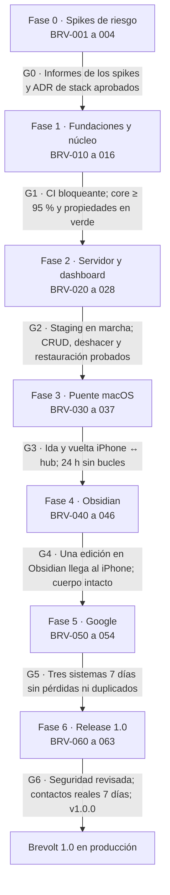

# Brevolt — Proceso de desarrollo y backlog

## Cómo usar este documento

Este documento convierte la [especificación de Brevolt](spec.md) en 7 fases y 44 issues listos para el flujo PO → Dev → @raul de Multica. Cada fase termina en una puerta de calidad que @raul valida antes de abrir la siguiente.

1. **El PO crea un issue por cada entrada `BRV-xxx`**, con su título, descripción, criterios de aceptación, tests obligatorios y dependencias tal como aparecen aquí. El código `BRV-xxx` va en el título para trazar ramas y PRs.
2. **El PO solo marca `po:ready`** cuando el issue cumple la Definition of Ready y todas sus dependencias están cerradas.
3. **El Developer trabaja un issue por PR**, sigue las convenciones de este documento y no da el issue por terminado sin cumplir la Definition of Done.
4. **El Code Reviewer revisa** contra los criterios de aceptación y los requisitos `R-xxx` citados.
5. **@raul hace la revisión final y la QA**, y es el único que cierra una puerta de fase.

**Idioma.** Issues y comentarios en español; títulos de issue, código, ramas, commits y PRs en inglés.

**Etiquetas.** `phase:0` a `phase:6`; `area:core`, `area:server`, `area:dashboard`, `area:bridge`, `area:obsidian`, `area:google`, `area:infra`; `type:spike`, `type:feature`, `type:test`, `type:chore`; `security` para todo lo que toque secretos, autenticación o datos personales; `po:ready` cuando el issue está listo para desarrollo.

**Regla de oro.** Ningún issue puede tocar contactos reales. Hasta cerrar la fase 5, todo se prueba con cuentas de prueba y datos sintéticos.

## Roadmap

Las fases van en orden estricto: ninguna empieza hasta que @raul cierra la puerta de la anterior. Dentro de una fase, los issues sin dependencias entre sí pueden ir en paralelo.



La única excepción al orden es BRV-034 (esqueleto del bridge), que solo depende del ADR y puede adelantarse durante la fase 2 si hay capacidad libre.

## Definition of Ready y Definition of Done

Un issue entra en desarrollo solo si cumple la DoR y se cierra solo si cumple la DoD; el PO comprueba la primera y el Code Reviewer la segunda.

**Definition of Ready (antes de `po:ready`):**

- [ ] Título en inglés con su `BRV-xxx`, y descripción con el objetivo en una o dos frases.
- [ ] Requisitos de la especificación citados (`R-SYNC-*`, `R-BR-*`, `R-OB-*`, `R-SEC-*`).
- [ ] Criterios de aceptación comprobables, cada uno con un resultado observable.
- [ ] Tests obligatorios listados por nivel (unitario, integración, contrato, E2E).
- [ ] Dependencias cerradas y fuera de alcance explícito.
- [ ] Tamaño abarcable en un PR de menos de unas 400 líneas cambiadas, sin contar tests ni fixtures. Si no cabe, se divide.

**Definition of Done (antes de cerrar):**

- [ ] CI en verde: lint, typecheck, tests, cobertura, gitleaks, CodeQL y auditoría de dependencias.
- [ ] Todos los tests obligatorios del issue añadidos y pasando; los umbrales de cobertura de su paquete se mantienen.
- [ ] Cero secretos, datos reales o URLs privadas en el diff.
- [ ] Logs nuevos sin datos personales (R-SEC-9).
- [ ] Documentación actualizada si cambia la API, la configuración o el despliegue.
- [ ] Changeset añadido si el cambio afecta a un paquete publicable.
- [ ] Revisión del Code Reviewer aprobada y validación final de @raul.

## Convenciones: repositorio, ramas, commits, PRs y CI

Un monorepo público en la organización `brevolt` de GitHub, con la rama `main` siempre desplegable y protegida.

**Estructura del repositorio:**

```
brevolt/
  packages/core/          # modelo, normalización, merge, mapeo Markdown (TS puro)
  packages/contracts/     # esquemas Zod, OpenAPI generado y fixtures JSON compartidas
  apps/server/            # Fastify + SQLite (Drizzle) + adaptadores
  apps/dashboard/         # React, servido por el servidor
  apps/obsidian-plugin/   # plugin de Obsidian
  apps/bridge-macos/      # app Swift (Xcode, SwiftPM)
  spikes/                 # código de la fase 0, nunca importado por producción
  docs/adr/               # decisiones de arquitectura
  deploy/                 # docker-compose.yml, .env.example
```

**Ramas y commits:**

- Ramas `feat/BRV-023-contacts-api`, `fix/BRV-023-...`, `chore/...`, `spike/...`, creadas desde `main`.
- Commits con Conventional Commits (`feat(server): add contacts PATCH with If-Match`) y firmados.
- Squash merge; el título del PR es el mensaje final y cita `BRV-xxx`.

**Pull requests.** Plantilla obligatoria con: issue enlazado, requisitos `R-xxx` cubiertos, cómo probarlo, tests añadidos, impacto en seguridad o datos personales, y capturas para cambios del dashboard.

**CI (GitHub Actions), bloqueante en todos los PRs:**

| Job | Qué comprueba | Bloquea si |
| --- | --- | --- |
| `lint` | ESLint y Prettier (TS); SwiftLint (bridge) | Cualquier error |
| `typecheck` | `tsc --noEmit` en modo estricto en todo el monorepo | Cualquier error |
| `test` | Vitest con cobertura por paquete | Falla un test o baja de umbral |
| `test-swift` | `swift test` del bridge en runner macOS | Falla un test |
| `e2e` | Playwright contra servidor y dashboard reales con base de datos temporal | Falla un escenario |
| `secrets` | gitleaks sobre el diff y el historial | Cualquier hallazgo |
| `codeql` | Análisis estático de TS y Swift | Alerta alta o crítica |
| `audit` | `pnpm audit --prod` | Vulnerabilidad alta o crítica sin excepción documentada |
| `docker` | Build de la imagen y escaneo con Trivy | Vulnerabilidad crítica |

El job `e2e` y el escaneo de la imagen se activan a partir de la fase 2; `test-swift`, a partir de la fase 3.

## Estrategia de tests

El riesgo principal es perder o corromper contactos, así que el grueso de los tests va al núcleo de fusión y normalización, que es TypeScript puro y se prueba rápido y sin red; los extremos (Contactos, Google, Obsidian) se aislan detrás de interfaces con dobles de prueba.

| Nivel | Qué cubre | Herramienta | Umbral o regla |
| --- | --- | --- | --- |
| Unitario | `core`: normalización, `merge`, mapeo Markdown; lógica de servidor y plugin | Vitest | `core` ≥ 95 % líneas y ramas; resto ≥ 80 % |
| Propiedades | Invariantes de `merge` y del mapeo Markdown | fast-check, 1.000 ejecuciones por propiedad en CI | Obligatorio en todo cambio de `core` |
| Contrato | API pública y contrato `bridge/*` | Esquemas Zod + OpenAPI generado; fixtures JSON en `packages/contracts` que consumen TS y Swift | Un cambio de contrato sin actualizar fixtures rompe CI |
| Integración de servidor | Rutas HTTP con SQLite real en fichero temporal; migraciones | Vitest + `fastify.inject` | Cada endpoint: caso feliz, validación, auth y concurrencia |
| Integración de adaptadores | Adaptador de Google contra respuestas grabadas | Vitest + MSW con fixtures sintéticas | Incluye `syncToken` caducado y etag obsoleto |
| Swift | Mapeo `CNContact` ↔ contrato, cliente HTTP, lógica de cola | XCTest con un `ContactStore` falso detrás de un protocolo | Sin acceso real a Contactos en CI |
| E2E del dashboard | Flujos de usuario en el navegador | Playwright | Cada fase añade sus flujos |
| E2E de sistema | Hub completo con clientes simulados (script que imita al bridge, servidor falso de Google, vault temporal) | Vitest en `apps/server/e2e` | Escenarios de ida y vuelta, conflicto y bucle |
| Manual en dispositivo | Bridge contra Contactos reales de una cuenta de prueba; plugin en Obsidian de escritorio y móvil | Checklist en el issue | Obligatorio para cerrar fases 3 y 4 |
| Soak | Sistema completo funcionando sin intervención | Entorno de staging | 24 h en fase 3, 7 días en fase 5 |

**Invariantes que deben tener test de propiedades:**

- **Idempotencia:** `merge` aplicado dos veces da el mismo resultado que una vez.
- **Un solo lado gana:** si solo cambió un lado, el resultado es ese lado, sin conflictos.
- **Sin pérdida:** ningún valor de un campo multivalor desaparece salvo que un lado lo haya borrado explícitamente.
- **Simetría de conflictos:** intercambiar hub y externo produce los mismos conflictos.
- **Ida y vuelta del Markdown:** `parse(render(contact)) == contact`, y el cuerpo de la nota se conserva byte a byte.
- **Normalización estable:** `normalize(normalize(x)) == normalize(x)`.

**Datos de prueba.** Solo sintéticos, generados con un generador con semilla (`packages/contracts/fixtures/generate.ts`) que cubra nombres con acentos y emojis, teléfonos de varios países y mal formados, cumpleaños sin año y contactos sin nombre. Las respuestas grabadas de Google se anonimizan antes de entrar al repositorio.

**Regresiones.** Todo bug de sincronización se corrige primero con un test que lo reproduce, añadido al corpus de fixtures de `merge`.

## Entornos y cuentas de prueba

Tres entornos y un juego de cuentas de prueba separados de los datos reales de @raul; ningún agente tiene credenciales de producción.

| Entorno | Dónde | Datos | Quién lo usa |
| --- | --- | --- | --- |
| Local / CI | Máquina del agente y GitHub Actions | Fixtures sintéticas, base de datos temporal | Developer, CI |
| Staging | Homelab, contenedor `brevolt-staging` con su propio volumen | Cuentas de prueba (abajo) | @raul y agentes en issues con prueba manual |
| Producción | Homelab, contenedor `brevolt` | Contactos reales | Solo @raul, a partir de cerrar la fase 5 |

**Cuentas de prueba (las crea @raul antes de la fase 0):**

- [ ] Apple ID de pruebas, iniciado en un usuario de macOS dedicado (o una máquina virtual) y en un iPhone o simulador de pruebas, con unos 200 contactos sintéticos importados desde el generador.
- [ ] Cuenta de Google de pruebas con su propio proyecto en Google Cloud y cliente OAuth, y los mismos contactos sintéticos con variaciones para probar emparejamiento.
- [ ] Vault de Obsidian de pruebas, sincronizado entre escritorio y móvil.
- [ ] Secretos de staging (client ID y secret de Google, `ENCRYPTION_KEY`, tokens) solo en el gestor de secretos del homelab; los agentes reciben acceso al entorno de staging, nunca los valores.

## Fase 0 — Spikes de riesgo

Cuatro spikes que validan lo que podría tumbar el proyecto antes de escribir código de producción. Su código vive en `spikes/` y su resultado es un informe y un ADR, no funcionalidad.

**Puerta G0:** los tres spikes técnicos tienen informe con resultado claro (funciona, funciona con limitaciones o no funciona) y el ADR de stack está aprobado. Si un spike falla, @raul decide si se ajusta la especificación antes de seguir.

### BRV-001 · Spike: Contacts change history on macOS

Comprobar que un CLI en Swift puede leer cambios de Contactos de forma incremental y excluir sus propias escrituras. Requisitos: R-BR-1, R-BR-3, R-BR-5.

- Lee altas, modificaciones y borrados con `CNChangeHistoryFetchRequest` desde un token guardado.
- Escribe con `transactionAuthor` y demuestra que `excludedTransactionAuthors` las oculta del historial.
- Mide el tiempo de una lectura completa de 1.000 contactos sintéticos.
- Documenta qué pasa cuando el token caduca y cómo se detecta.

**Entregable:** `spikes/contacts-history/` y `docs/spikes/001-contacts-history.md` con resultados y fragmentos de código reutilizables.

### BRV-002 · Spike: Google People API sync

Comprobar el ciclo completo con People API en la cuenta de prueba. Requisitos: R-SYNC-5.

- OAuth con el cliente propio y obtención de refresh token.
- Listado inicial con `syncToken` y listado incremental tras cambiar contactos desde la web de Google.
- Actualización con etag y comportamiento documentado con un etag obsoleto.
- Comportamiento documentado de un `syncToken` caducado y de los límites de cuota.

**Entregable:** `spikes/google-people/` y `docs/spikes/002-google-people.md`, incluidas respuestas de ejemplo anonimizadas para usar como fixtures.

### BRV-003 · Spike: Obsidian plugin network and frontmatter

Comprobar que un plugin mínimo puede hablar con un servidor local y editar frontmatter sin tocar el cuerpo. Requisitos: R-OB-2, R-OB-3.

- `requestUrl` contra un servidor HTTP local funciona en escritorio y en móvil (a través de Tailscale).
- `processFrontMatter` modifica claves sin alterar el cuerpo, verificado comparando bytes.
- Documenta dónde guarda Obsidian los ajustes del plugin y si hay almacén de secretos disponible (R-SEC-12).

**Entregable:** `spikes/obsidian-plugin/` y `docs/spikes/003-obsidian-plugin.md`.

### BRV-004 · ADR: stack and repository layout

Registrar en `docs/adr/` las decisiones de stack: Node 22 LTS, TypeScript estricto, Fastify, SQLite con Drizzle, Zod, React para el dashboard, pnpm workspaces, Vitest, fast-check, Playwright, SwiftUI para el bridge y licencia.

- Un ADR por decisión, con alternativas descartadas y motivo.
- La licencia (MIT o AGPL-3.0) queda decidida por @raul en el ADR correspondiente.
- Depende de: BRV-001, BRV-002, BRV-003 (sus hallazgos pueden cambiar decisiones).

## Fase 1 — Fundaciones y núcleo

El repositorio con su seguridad desde el primer commit y el paquete `core`, que concentra la lógica de mayor riesgo y se prueba sin red ni sistemas externos.

**Puerta G1:** CI completo en verde y bloqueante; `core` con cobertura ≥ 95 % y las seis invariantes con tests de propiedades; las cuatro filas de la tabla de fusión de la especificación cubiertas por fixtures.

### BRV-010 · Bootstrap monorepo

Monorepo pnpm con la estructura de este documento, TypeScript estricto, ESLint, Prettier, Vitest y Changesets. Requisitos: R-SEC-1, R-SEC-2, R-SEC-15. Depende de: BRV-004.

- **Criterios:** `pnpm install && pnpm test` funciona en limpio; `README`, `CONTRIBUTING`, `SECURITY.md`, `LICENSE`, `.env.example` solo con marcadores y `.gitignore` que excluye `.env*` salvo el ejemplo.
- **Tests:** un test de humo por paquete para que la tubería de tests esté viva.

### BRV-011 · CI pipeline and repository security

Workflows de GitHub Actions con los jobs `lint`, `typecheck`, `test`, `secrets`, `codeql` y `audit`, y configuración de seguridad del repositorio. Requisitos: R-SEC-5, R-SEC-13, R-SEC-15. Depende de: BRV-010.

- **Criterios:** todos los jobs bloqueantes en PRs a `main`; gitleaks también como hook de pre-commit; Renovate configurado; rama protegida con revisión obligatoria y commits firmados; secret scanning con push protection activo.
- **Tests:** un PR de prueba con un secreto falso es bloqueado por `secrets` (se documenta y se cierra sin merge).

### BRV-012 · Core domain model and schemas

Tipos y esquemas Zod del contacto, campos multivalor, etiquetas, campos propios, `external_link` y snapshot de base, en `packages/core` y `packages/contracts`. Requisitos: modelo de datos de la especificación. Depende de: BRV-010.

- **Criterios:** un único origen de tipos (inferidos de Zod) usado por servidor y plugin; los UUID son v7.
- **Tests:** validación de casos válidos e inválidos para cada esquema.

### BRV-013 · Core normalization

Normalización de teléfonos (E.164 con libphonenumber-js y región por defecto), emails, fechas con y sin año, y vocabulario de etiquetas con traductores para Apple, Google y vCard. Depende de: BRV-012.

- **Criterios:** un teléfono no parseable se conserva tal cual con la marca `unparsed`; todas las etiquetas de Apple y Google documentadas en los spikes tienen traducción de ida y vuelta.
- **Tests:** unitarios con teléfonos de al menos 10 países y formatos raros; propiedad de normalización estable.

### BRV-014 · Core merge: scalar fields

Función pura `merge(base, hub, external)` para campos escalares (nombre, empresa, cargo, cumpleaños). Requisitos: R-SYNC-1. Depende de: BRV-013.

- **Criterios:** devuelve `hubPatch`, `externalPatch` y `conflicts` según la tabla de la especificación; sin efectos secundarios ni E/S.
- **Tests:** fixtures para las cuatro filas de la tabla; propiedades de idempotencia, un solo lado gana y simetría de conflictos.

### BRV-015 · Core merge: multi-value fields and deletions

Extiende `merge` a teléfonos, emails, direcciones y URLs como conjuntos con clave `kind` + `normalized`, cambios de etiqueta y borrado de contacto. Requisitos: R-SYNC-1 y reglas de borrado. Depende de: BRV-014.

- **Criterios:** altas y bajas de ambos lados se combinan; un borrado externo produce la marca `deleted-upstream` y nunca un borrado directo.
- **Tests:** fixtures de altas y bajas cruzadas y de cambio de etiqueta; propiedad de sin pérdida.

### BRV-016 · Synthetic data generator and fixture corpus

Generador con semilla en `packages/contracts/fixtures` y corpus inicial de casos de fusión. Depende de: BRV-012.

- **Criterios:** genera contactos con acentos, emojis, teléfonos de varios países y mal formados, cumpleaños sin año y contactos sin nombre; exporta a vCard para importar en las cuentas de prueba.
- **Tests:** la misma semilla produce exactamente la misma salida.

## Fase 2 — Servidor y dashboard

El servidor desplegable con la API de contactos, la seguridad de base y un dashboard para ver y editar contactos a mano; todavía sin ningún sistema externo conectado.

**Puerta G2:** Brevolt corre en staging desde la imagen publicada; crear, editar, deshacer y exportar contactos funciona desde el dashboard; los E2E de Playwright pasan; un backup se restaura con éxito en un ensayo documentado.

### BRV-020 · Database schema and migrations

Esquema SQLite con Drizzle para todas las tablas de la especificación, en modo WAL. Depende de: BRV-012.

- **Criterios:** migraciones versionadas y aplicadas al arrancar; copia automática de la base antes de cada migración; restricción única en (`system`, `external_id`).
- **Tests:** integración que aplica todas las migraciones sobre una base vacía y sobre una con datos de la versión anterior.

### BRV-021 · Config, secrets loading and logging

Carga de configuración validada con Zod desde variables de entorno y variantes `*_FILE`, y logger estructurado con redacción. Requisitos: R-SEC-1, R-SEC-4, R-SEC-9. Depende de: BRV-010.

- **Criterios:** el proceso no arranca si falta un secreto obligatorio o `ENCRYPTION_KEY` tiene menos de 32 bytes, con un mensaje claro y sin mostrar valores; los logs redactan teléfonos, emails, nombres y tokens.
- **Tests:** unitarios de cada caso de configuración inválida; test que registra un contacto completo y comprueba que no aparece ningún dato personal en la salida.

### BRV-022 · Client tokens: auth, scopes and rate limiting

Tokens de cliente con hash, alcance (`bridge`, `obsidian`), caducidad por inactividad y revocación; rate limiting en autenticación. Requisitos: R-SEC-7, R-SEC-8. Depende de: BRV-020, BRV-021.

- **Criterios:** el valor del token se muestra una sola vez al crearlo; un token `bridge` recibe 403 fuera de `/v1/bridge/*` y viceversa; tras 90 días sin uso deja de funcionar.
- **Tests:** integración por cada combinación de alcance y ruta; test de rate limiting; test de comparación en tiempo constante.

### BRV-023 · Contacts API with versioning and change log

Endpoints `GET/POST/PATCH/DELETE /v1/contacts` con versión por contacto, `If-Match` y escritura en `change_log`. Depende de: BRV-022.

- **Criterios:** `PATCH` sin `If-Match` o con versión antigua devuelve 428 o 412; `DELETE` hace soft delete; cada escritura deja filas en `change_log` con `actor` y `operation_id`.
- **Tests:** integración con caso feliz, validación, auth y dos `PATCH` concurrentes sobre la misma versión.

### BRV-024 · Undo, export and health

`POST /v1/changes/:operationId/undo`, `GET /v1/export?format=vcf|json` y `GET /healthz`. Depende de: BRV-023.

- **Criterios:** deshacer revierte exactamente una operación y queda registrado como operación nueva; la exportación vCard importa sin errores en Contactos de macOS (comprobación manual) y la JSON valida contra el esquema.
- **Tests:** integración de deshacer tras alta, edición y borrado; ida y vuelta de la exportación JSON.

### BRV-025 · Dashboard authentication

Acceso al dashboard con un único usuario administrador: contraseña con hash argon2id fijada en el primer arranque, sesión en cookie `HttpOnly`, `Secure` y `SameSite=Strict`, y protección CSRF. Depende de: BRV-022.

- **Criterios:** sin sesión, todas las rutas del dashboard redirigen al login; cerrar sesión invalida la cookie en el servidor.
- **Tests:** integración de login correcto e incorrecto, caducidad de sesión y CSRF; E2E de login.

### BRV-026 · Dashboard: contacts list and detail

Lista con búsqueda, ficha completa y edición de campos vCard y enriquecimiento (nota Markdown, etiquetas, campos propios), con historial y deshacer. Depende de: BRV-024, BRV-025.

- **Criterios:** usable con 5.000 contactos sintéticos sin bloquear la interfaz; editar respeta la versión y muestra un aviso si alguien cambió el contacto entretanto.
- **Tests:** E2E de buscar, crear, editar, deshacer y borrar.

### BRV-027 · Dashboard: settings and client tokens

Pantalla de ajustes para crear y revocar tokens de cliente, región por defecto de teléfonos y estado de cada sistema conectado. Depende de: BRV-025.

- **Criterios:** el token se muestra una vez con botón de copiar y nunca vuelve a mostrarse; la lista muestra alcance, nombre y `last_seen`.
- **Tests:** E2E de crear un token, usarlo contra la API y revocarlo.

### BRV-028 · Docker image, compose and backups

Imagen mínima con usuario no root y sistema de ficheros de solo lectura salvo el volumen de datos, `deploy/docker-compose.yml`, backup diario con retención de 30 días, y workflow de release con firma cosign y SBOM. Requisitos: R-SEC-14 y backups de la especificación. Depende de: BRV-021.

- **Criterios:** `docker compose up` con un `.env` mínimo arranca un servidor funcional; el escaneo con Trivy no tiene vulnerabilidades críticas; existe una guía de restauración probada.
- **Tests:** job de CI que levanta el compose y consulta `/healthz`; ensayo de restauración documentado en el issue.

## Fase 3 — Puente macOS

El primer sistema externo: la orquestación de sincronización en el servidor, las bandejas de decisiones del dashboard y la app de barra de menú que conecta Contactos.

**Puerta G3:** con la cuenta de prueba, un cambio hecho en el iPhone llega al hub y uno hecho en el dashboard llega al iPhone, en ambos casos en menos de 2 minutos con el Mac encendido; 24 horas de soak sin bucles, duplicados ni cambios fantasma; conflictos y borrados aparecen solo en el dashboard.

### BRV-030 · Sync orchestration and bridge endpoints

`POST /v1/bridge/changes`, `GET /v1/bridge/pending` y `POST /v1/bridge/ack`, conectados a `merge`, `external_link`, `sync_base` y la cola de cambios pendientes por cliente. Requisitos: R-SYNC-2, R-SYNC-3, contrato del puente. Depende de: BRV-015, BRV-023.

- **Criterios:** reenviar el mismo lote con el mismo `operation_id` no produce cambios; tras un ack, base y `external_link` se actualizan en la misma transacción; un cliente nunca recibe en `pending` sus propios cambios; una instantánea completa se fusiona igual que un lote incremental.
- **Tests:** contrato con fixtures JSON compartidas; integración de lote duplicado, ack con error y reintento; E2E de sistema con un script que imita al bridge y comprueba que no hay bucle tras 100 ciclos.

### BRV-031 · Conflicts and proposals model and API

Registro de conflictos, propuestas de fusión de duplicados y borrados `deleted-upstream`, con sus endpoints de listado y resolución. Requisitos: R-SYNC-4, reglas de borrado y duplicados. Depende de: BRV-030.

- **Criterios:** un campo en conflicto no se escribe en ningún sistema hasta resolverse; resolver propaga el valor elegido a todos los sistemas vinculados; aceptar un borrado hace soft delete y lo propaga.
- **Tests:** integración de los tres tipos de decisión y de sus tres resoluciones posibles (hub, externo, valor manual).

### BRV-032 · Dashboard: decisions inbox

Bandeja única en el dashboard para conflictos, propuestas de fusión y borrados, con vista lado a lado de los valores. Depende de: BRV-031, BRV-026.

- **Criterios:** contador de pendientes visible en la navegación; cada decisión muestra base, hub y externo; resolver no requiere salir de la bandeja.
- **Tests:** E2E de resolver un conflicto de cada tipo.

### BRV-033 · Dry-run mode and sync diff view

Modo dry-run por sistema, activo por defecto en la primera conexión, que calcula y muestra en el dashboard lo que se escribiría sin escribir nada. Requisitos: requisito no funcional de seguridad ante fallos. Depende de: BRV-030.

- **Criterios:** con dry-run activo, el bridge no recibe ningún cambio pendiente y el dashboard muestra el diff completo; desactivarlo requiere confirmación explícita.
- **Tests:** integración que verifica cero escrituras externas en dry-run; E2E de revisar el diff y activar el sync.

### BRV-034 · Bridge app skeleton

App SwiftUI de barra de menú con ajustes (URL del servidor, token en el Llavero, contenedor de iCloud), estado, "Sincronizar ahora", "Pausar" y arranque al iniciar sesión. Requisitos: R-BR-4, R-SEC-11. Depende de: BRV-004.

- **Criterios:** el token nunca se escribe en `UserDefaults` ni en ficheros; la app pide acceso a Contactos solo al activar el sync; cliente HTTP que valida el certificado del servidor.
- **Tests:** XCTest del cliente HTTP contra fixtures del contrato y del almacenamiento del token con un Llavero falso.

### BRV-035 · Bridge: Contacts to server

Lectura incremental con historial de cambios desde el token guardado, normalización al contrato y subida en lotes; instantánea completa si el token deja de ser válido. Requisitos: R-BR-1, R-BR-5, R-BR-6. Depende de: BRV-030, BRV-034.

- **Criterios:** solo lee el contenedor configurado; reacciona a `CNContactStoreDidChange` en segundos; un fallo de red reintenta con backoff sin perder el token.
- **Tests:** XCTest del mapeo `CNContact` → contrato con un `ContactStore` falso; checklist manual en el Mac de pruebas con altas, ediciones y borrados desde el iPhone.

### BRV-036 · Bridge: server to Contacts

Consulta de pendientes cada 60 segundos y bajo demanda, aplicación con `CNSaveRequest` marcada con `transactionAuthor`, y ack por cambio. Requisitos: R-BR-2, R-BR-3. Depende de: BRV-035.

- **Criterios:** las escrituras propias no vuelven a subirse; un error al guardar un contacto se reporta en su ack sin bloquear el resto del lote; las altas devuelven su identificador local.
- **Tests:** XCTest de la aplicación de cambios y del ack; checklist manual de ida y vuelta y prueba de bucle durante una hora.

### BRV-037 · Bridge signing, notarization and release

Workflow que compila, firma, notariza y publica el bridge en GitHub Releases, con certificados solo como secretos de CI. Requisitos: R-SEC-11. Depende de: BRV-036.

- **Criterios:** el `.dmg` o `.zip` publicado abre sin avisos de Gatekeeper en un Mac limpio; ningún certificado ni contraseña en el repositorio.
- **Tests:** verificación con `spctl` y `codesign --verify` dentro del workflow.

## Fase 4 — Obsidian

El plugin que proyecta los contactos del hub en notas y devuelve lo que se edite en ellas; solo sincroniza, todas las decisiones siguen en el dashboard.

**Puerta G4:** con el vault de prueba, editar un teléfono en una nota lo cambia en el iPhone de prueba; el cuerpo de las notas no pierde ni un byte en 24 horas de uso; el plugin funciona en escritorio y móvil.

### BRV-040 · Core Markdown mapping

Conversión contacto ↔ nota en `packages/core`: frontmatter compatible con VCF Contacts, claves `cf-*`, claves libres y cuerpo. Requisitos: formato de nota de la especificación. Depende de: BRV-015.

- **Criterios:** las claves vCard, `tags`, claves propias y cuerpo se separan según la tabla de propiedad de campos; claves desconocidas se conservan como campos propios.
- **Tests:** propiedad de ida y vuelta (`parse(render(c)) == c`); cuerpo conservado byte a byte; compatibilidad con notas de ejemplo de VCF Contacts.

### BRV-041 · Plugin skeleton and settings

Plugin con ajustes de URL del servidor, API key, carpeta de contactos e intervalo, y botón "Probar conexión". Requisitos: R-OB-8, R-SEC-12. Depende de: BRV-022, BRV-003.

- **Criterios:** usa el almacén de secretos de Obsidian si el spike BRV-003 confirmó que existe; si no, avisa en los ajustes de que la API key se guarda dentro del vault; solo acepta URLs HTTPS salvo direcciones locales o de Tailscale.
- **Tests:** unitarios de validación de ajustes y del cliente HTTP con respuestas simuladas.

### BRV-042 · Plugin: pull and project notes

Descarga incremental con `updatedSince` al abrir el vault y cada intervalo, y escritura de notas con `processFrontMatter`. Requisitos: R-OB-1, R-OB-3. Depende de: BRV-040, BRV-041.

- **Criterios:** nunca sobrescribe el fichero completo; una nota abierta en el editor no pierde la edición en curso; renombrar un contacto en el hub renombra la nota con el gestor de ficheros (R-OB-7).
- **Tests:** unitarios con un vault simulado; checklist manual en escritorio y móvil.

### BRV-043 · Plugin: push edits

Envío de cambios de claves gestionadas y cuerpo con 3 segundos de espera y `If-Match: cf-version`; reescritura de la nota con el resultado de la fusión si la versión no coincide. Requisitos: R-OB-2. Depende de: BRV-042.

- **Criterios:** editar solo el cuerpo no toca las claves gestionadas y viceversa; `cf-id` y `cf-version` editados a mano se restauran y no se envían.
- **Tests:** unitarios de debounce y de versión antigua; E2E de sistema con vault temporal que edita una nota y comprueba el cambio en el hub.

### BRV-044 · Plugin: new notes, deletions and renames

Nota nueva sin `cf-id` en la carpeta crea un contacto; borrar una nota crea una propuesta de borrado; renombrar una nota no cambia el contacto. Requisitos: R-OB-4, R-OB-5, R-OB-7. Depende de: BRV-043, BRV-031.

- **Criterios:** la propuesta de borrado aparece en la bandeja del dashboard y la nota se vuelve a crear si se rechaza.
- **Tests:** unitarios de cada evento del vault; E2E de sistema de alta y de borrado rechazado.

### BRV-045 · Plugin: pending conflict notice

Si un contacto tiene una decisión pendiente, la nota muestra un aviso de solo lectura con enlace al dashboard y sus claves gestionadas no se envían. Requisitos: R-OB-6. Depende de: BRV-043, BRV-031.

- **Criterios:** el aviso desaparece en el siguiente pull tras resolver en el dashboard; el cuerpo de la nota sigue editable y sincronizándose.
- **Tests:** unitarios de bloqueo de envío; E2E de sistema de conflicto creado, aviso visible, resolución y aviso retirado.

### BRV-046 · Plugin release to community plugins

Publicación del plugin en el directorio de Obsidian. Depende de: BRV-045.

- **Criterios:** cumple las directrices de revisión de plugins de Obsidian; `manifest.json` y `versions.json` correctos; release automatizado desde etiqueta; README con instalación y configuración.
- **Tests:** build de release en CI; instalación manual desde el zip en un vault limpio.

## Fase 5 — Google

El adaptador de Google en el servidor, con la importación inicial en modo emparejamiento, que es la parte más delicada por los duplicados.

**Puerta G5:** los tres sistemas de prueba (iCloud, Google y Obsidian) sincronizados 7 días seguidos sin cambios fantasma, duplicados ni pérdidas; todos los duplicados de la importación inicial llegaron como propuestas. Al cerrarla, @raul decide cuándo conectar sus contactos reales.

### BRV-050 · Google OAuth connection

Conexión de la cuenta de Google desde los ajustes del dashboard, con el cliente OAuth del usuario, refresh token cifrado y detección de token inválido. Requisitos: R-SEC-3, R-SEC-10. Depende de: BRV-027, BRV-002.

- **Criterios:** el refresh token se guarda cifrado con AES-256-GCM y nunca aparece en logs ni respuestas; un token revocado o caducado se muestra como error en el estado del sistema con el paso para reconectar; desconectar borra el token.
- **Tests:** unitarios de cifrado y descifrado con clave incorrecta; integración del flujo OAuth contra un servidor simulado.

### BRV-051 · Google adapter: pull

Lectura incremental con `syncToken` cada 5 minutos (configurable) y bajo demanda, y resincronización completa si el token caduca, pasando todo por `merge`. Depende de: BRV-050, BRV-030.

- **Criterios:** un `syncToken` caducado no produce duplicados; los errores de cuota se reintentan con backoff.
- **Tests:** integración con MSW y fixtures anonimizadas del spike, incluidos token caducado y error de cuota.

### BRV-052 · Google adapter: push

Escritura de cambios del hub con etag; ante etag obsoleto, releer y refusionar. Requisitos: R-SYNC-5. Depende de: BRV-051.

- **Criterios:** ningún cambio se escribe en Google con dry-run activo; tras escribir, base y etag se actualizan en la misma transacción.
- **Tests:** integración de escritura correcta, etag obsoleto y fallo de red a mitad de lote; E2E de sistema hub ↔ servidor falso de Google sin bucles en 100 ciclos.

### BRV-053 · Initial import with matching

Primera sincronización de Google en modo emparejamiento: coincidencias por teléfono o email normalizado generan propuestas de fusión; el resto, contactos nuevos con su `external_link`. Depende de: BRV-052, BRV-031.

- **Criterios:** ninguna fusión automática; el dashboard muestra un resumen de la importación (nuevos, propuestas, ignorados) antes de desactivar el dry-run.
- **Tests:** integración con el corpus sintético de variaciones entre iCloud y Google preparado en las cuentas de prueba.

### BRV-054 · Google setup guide

Guía paso a paso para crear el proyecto y el cliente OAuth en Google Cloud, con la advertencia de publicar la app en "In production" para que el refresh token no caduque a los 7 días. Depende de: BRV-050.

- **Criterios:** alguien sin contexto completa la conexión siguiendo solo la guía; el dashboard enlaza a ella desde el botón de conectar Google.
- **Tests:** prueba manual de @raul con una cuenta de Google nueva.

## Fase 6 — Release 1.0 y proceso de versiones

La fase final prepara Brevolt para que lo use otra persona: documentación, revisión de seguridad, paso de @raul a sus contactos reales y la versión 1.0.0.

**Puerta G6:** documentación completa revisada; modelo de amenazas sin riesgos altos abiertos; contactos reales de @raul sincronizados 7 días sin incidencias; v1.0.0 publicada en las tres piezas.

### BRV-060 · User documentation

Guía de instalación con Docker Compose, configuración, acceso por Tailscale, conexión de cada sistema, backups y restauración, y resolución de problemas. Depende de: BRV-054, BRV-046, BRV-037.

- **Criterios:** una instalación desde cero siguiendo solo la documentación funciona en menos de 30 minutos (prueba de @raul en una máquina limpia).

### BRV-061 · Threat model and security review

Modelo de amenazas en `docs/security/` (activos, actores, superficies: API, dashboard, bridge, plugin, OAuth, backups) y revisión de todos los `R-SEC-*` contra el código. Depende de: BRV-053.

- **Criterios:** cada amenaza tiene mitigación implementada o riesgo aceptado por @raul; ningún hallazgo alto abierto; historial de git completo escaneado con gitleaks sin hallazgos.

### BRV-062 · Production cutover runbook

Runbook para que @raul pase de las cuentas de prueba a sus contactos reales: backup previo de iCloud y Google (exportación vCard), conexión con dry-run, revisión del diff y de las propuestas, y activación. Depende de: BRV-061.

- **Criterios:** el runbook incluye cómo volver atrás en cada paso; el ensayo en staging con una copia anonimizada sale limpio.

### BRV-063 · Release v1.0.0

Publicación coordinada de la imagen del servidor, el bridge y el plugin en 1.0.0, con notas de versión. Depende de: BRV-060, BRV-062.

- **Criterios:** imagen firmada con SBOM, bridge notarizado, plugin aprobado en el directorio; notas de versión generadas con Changesets.

**Proceso de versiones a partir de aquí:**

- **SemVer independiente por pieza** (servidor, bridge, plugin), con la versión de la API (`/v1`) como contrato compartido: un cambio incompatible en la API sube a `/v2` y convive con `/v1` al menos una versión menor.
- **Changesets** genera versiones y changelogs desde los PRs; un release es una etiqueta firmada que dispara los workflows de publicación.
- **Migraciones de base de datos** solo hacia delante, con backup automático previo (BRV-020); toda migración destructiva requiere ADR.
- **Hotfix:** rama `fix/` desde `main`, mismo CI completo, release de parche; si el fallo afecta a datos, se publica primero un aviso en el README y en las notas de versión.
- **Avisos de seguridad** por GitHub Security Advisories, siguiendo `SECURITY.md`.
