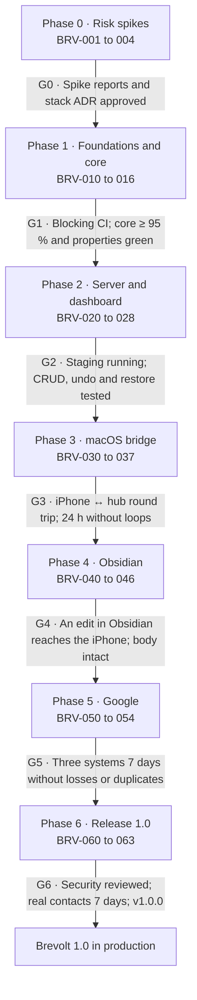

# Brevolt — Development process and backlog

## How to use this document

This document turns the [Brevolt specification](spec.md) into 7 phases and 44 issues ready for Multica's PO → Dev → @raul flow. Each phase ends in a quality gate that @raul validates before opening the next one.

1. **The PO creates one issue per `BRV-xxx` entry**, with its title, description, acceptance criteria, required tests and dependencies exactly as they appear here. The `BRV-xxx` code goes in the title so branches and PRs can be traced.
2. **The PO only marks `po:ready`** when the issue meets the Definition of Ready and all its dependencies are closed.
3. **The Developer works one issue per PR**, follows the conventions in this document and does not consider the issue finished until it meets the Definition of Done.
4. **The Code Reviewer reviews** against the acceptance criteria and the cited `R-xxx` requirements.
5. **@raul does the final review and QA**, and is the only one who closes a phase gate.

**Language.** Everything is in English: issues, comments, issue titles, code, branches, commits and PRs.

**Labels.** `phase:0` to `phase:6`; `area:core`, `area:server`, `area:dashboard`, `area:bridge`, `area:obsidian`, `area:google`, `area:infra`; `type:spike`, `type:feature`, `type:test`, `type:chore`; `security` for anything that touches secrets, authentication or personal data; `po:ready` when the issue is ready for development.

**Golden rule.** No issue may touch real contacts. Until phase 5 is closed, everything is tested with test accounts and synthetic data.

## Roadmap

Phases run in strict order: none starts until @raul closes the previous one's gate. Within a phase, issues with no dependencies between them can run in parallel.



The only exception to the order is BRV-034 (bridge skeleton), which depends only on the ADR and can be brought forward during phase 2 if there is spare capacity.

## Definition of Ready and Definition of Done

An issue enters development only if it meets the DoR and is closed only if it meets the DoD; the PO checks the former and the Code Reviewer the latter.

**Definition of Ready (before `po:ready`):**

- [ ] English title with its `BRV-xxx`, and a description stating the goal in one or two sentences.
- [ ] Specification requirements cited (`R-SYNC-*`, `R-BR-*`, `R-OB-*`, `R-SEC-*`).
- [ ] Testable acceptance criteria, each with an observable outcome.
- [ ] Required tests listed by level (unit, integration, contract, E2E).
- [ ] Dependencies closed and out-of-scope stated explicitly.
- [ ] Size fits in a PR of under roughly 400 changed lines, excluding tests and fixtures. If it does not fit, it is split.

**Definition of Done (before closing):**

- [ ] CI green: lint, typecheck, tests, coverage, gitleaks, CodeQL and dependency audit.
- [ ] All of the issue's required tests added and passing; its package's coverage thresholds hold.
- [ ] Zero secrets, real data or private URLs in the diff.
- [ ] New logs free of personal data (R-SEC-9).
- [ ] Documentation updated if the API, configuration or deployment changes.
- [ ] Changeset added if the change affects a publishable package.
- [ ] Code Reviewer review approved and final validation by @raul.

## Conventions: repository, branches, commits, PRs and CI

A public monorepo in the `brevolt` GitHub organization, with the `main` branch always deployable and protected.

**Repository structure:**

```
brevolt/
  packages/core/          # model, normalization, merge, Markdown mapping (pure TS)
  packages/contracts/     # Zod schemas, generated OpenAPI and shared JSON fixtures
  apps/server/            # Fastify + SQLite (Drizzle) + adapters
  apps/dashboard/         # React, served by the server
  apps/obsidian-plugin/   # Obsidian plugin
  apps/bridge-macos/      # Swift app (Xcode, SwiftPM)
  spikes/                 # phase 0 code, never imported by production
  docs/adr/               # architecture decisions
  deploy/                 # docker-compose.yml, .env.example
```

**Branches and commits:**

- Branches `feat/BRV-023-contacts-api`, `fix/BRV-023-...`, `chore/...`, `spike/...`, created from `main`.
- Commits follow Conventional Commits (`feat(server): add contacts PATCH with If-Match`) and are signed.
- Squash merge; the PR title is the final message and cites `BRV-xxx`.

**Pull requests.** Mandatory template with: linked issue, `R-xxx` requirements covered, how to test it, tests added, security or personal-data impact, and screenshots for dashboard changes.

**CI (GitHub Actions), blocking on every PR:**

| Job | What it checks | Blocks if |
| --- | --- | --- |
| `lint` | ESLint and Prettier (TS); SwiftLint (bridge) | Any error |
| `typecheck` | `tsc --noEmit` in strict mode across the whole monorepo | Any error |
| `test` | Vitest with per-package coverage | A test fails or coverage drops below threshold |
| `test-swift` | Bridge `swift test` on a macOS runner | A test fails |
| `e2e` | Playwright against the real server and dashboard with a temporary database | A scenario fails |
| `secrets` | gitleaks over the diff and the history | Any finding |
| `codeql` | Static analysis of TS and Swift | High or critical alert |
| `audit` | `pnpm audit --prod` | High or critical vulnerability without a documented exception |
| `docker` | Image build and Trivy scan | Critical vulnerability |

The `e2e` job and the image scan are enabled from phase 2; `test-swift`, from phase 3.

## Testing strategy

The main risk is losing or corrupting contacts, so the bulk of the tests goes to the merge and normalization core, which is pure TypeScript and is tested quickly and without network; the edges (Contacts, Google, Obsidian) are isolated behind interfaces with test doubles.

| Level | What it covers | Tool | Threshold or rule |
| --- | --- | --- | --- |
| Unit | `core`: normalization, `merge`, Markdown mapping; server and plugin logic | Vitest | `core` ≥ 95 % lines and branches; rest ≥ 80 % |
| Properties | `merge` and Markdown mapping invariants | fast-check, 1,000 runs per property in CI | Mandatory on every `core` change |
| Contract | Public API and `bridge/*` contract | Zod schemas + generated OpenAPI; JSON fixtures in `packages/contracts` consumed by TS and Swift | A contract change without updated fixtures breaks CI |
| Server integration | HTTP routes with real SQLite in a temporary file; migrations | Vitest + `fastify.inject` | Every endpoint: happy path, validation, auth and concurrency |
| Adapter integration | Google adapter against recorded responses | Vitest + MSW with synthetic fixtures | Includes expired `syncToken` and stale etag |
| Swift | `CNContact` ↔ contract mapping, HTTP client, queue logic | XCTest with a fake `ContactStore` behind a protocol | No real Contacts access in CI |
| Dashboard E2E | User flows in the browser | Playwright | Each phase adds its flows |
| System E2E | Full hub with simulated clients (script that mimics the bridge, fake Google server, temporary vault) | Vitest in `apps/server/e2e` | Round-trip, conflict and loop scenarios |
| Manual on device | Bridge against the real Contacts app of a test account; plugin in Obsidian desktop and mobile | Checklist in the issue | Mandatory to close phases 3 and 4 |
| Soak | Full system running unattended | Staging environment | 24 h in phase 3, 7 days in phase 5 |

**Invariants that must have property tests:**

- **Idempotence:** applying `merge` twice gives the same result as applying it once.
- **One side wins:** if only one side changed, the result is that side, with no conflicts.
- **No loss:** no value of a multi-value field disappears unless one side explicitly deleted it.
- **Conflict symmetry:** swapping hub and external produces the same conflicts.
- **Markdown round trip:** `parse(render(contact)) == contact`, and the note body is preserved byte for byte.
- **Stable normalization:** `normalize(normalize(x)) == normalize(x)`.

**Test data.** Synthetic only, produced by a seeded generator (`packages/contracts/fixtures/generate.ts`) that covers names with accents and emojis, phone numbers from several countries and malformed ones, birthdays without a year and contacts without a name. Recorded Google responses are anonymized before entering the repository.

**Regressions.** Every sync bug is fixed by first adding a test that reproduces it to the `merge` fixture corpus.

## Environments and test accounts

Three environments and a set of test accounts kept separate from @raul's real data; no agent has production credentials.

| Environment | Where | Data | Who uses it |
| --- | --- | --- | --- |
| Local / CI | Agent's machine and GitHub Actions | Synthetic fixtures, temporary database | Developer, CI |
| Staging | Homelab, `brevolt-staging` container with its own volume | Test accounts (below) | @raul and agents on issues with manual testing |
| Production | Homelab, `brevolt` container | Real contacts | Only @raul, once phase 5 is closed |

**Test accounts (created by @raul before phase 0):**

- [ ] Test Apple ID, signed in on a dedicated macOS user (or a virtual machine) and on a test iPhone or simulator, with about 200 synthetic contacts imported from the generator.
- [ ] Test Google account with its own Google Cloud project and OAuth client, and the same synthetic contacts with variations to test matching.
- [ ] Test Obsidian vault, synced between desktop and mobile.
- [ ] Staging secrets (Google client ID and secret, `ENCRYPTION_KEY`, tokens) only in the homelab secrets manager; agents get access to the staging environment, never the values.

## Phase 0 — Risk spikes

Four spikes that validate whatever could sink the project before any production code is written. Their code lives in `spikes/` and their output is a report and an ADR, not functionality.

**Gate G0:** the three technical spikes have a report with a clear outcome (works, works with limitations, or does not work) and the stack ADR is approved. If a spike fails, @raul decides whether the specification is adjusted before continuing.

### BRV-001 · Spike: Contacts change history on macOS

Verify that a Swift CLI can read changes from the Contacts app incrementally and exclude its own writes. Requirements: R-BR-1, R-BR-3, R-BR-5.

- Reads additions, modifications and deletions with `CNChangeHistoryFetchRequest` from a saved token.
- Writes with `transactionAuthor` and shows that `excludedTransactionAuthors` hides them from the history.
- Measures the time of a full read of 1,000 synthetic contacts.
- Documents what happens when the token expires and how it is detected.

**Deliverable:** `spikes/contacts-history/` and `docs/spikes/001-contacts-history.md` with results and reusable code snippets.

### BRV-002 · Spike: Google People API sync

Verify the full cycle with the People API on the test account. Requirements: R-SYNC-5.

- OAuth with the user's own client and obtaining a refresh token.
- Initial listing with `syncToken` and incremental listing after changing contacts from the Google web UI.
- Update with etag and documented behavior with a stale etag.
- Documented behavior of an expired `syncToken` and of quota limits.

**Deliverable:** `spikes/google-people/` and `docs/spikes/002-google-people.md`, including anonymized sample responses to use as fixtures.

### BRV-003 · Spike: Obsidian plugin network and frontmatter

Verify that a minimal plugin can talk to a local server and edit frontmatter without touching the body. Requirements: R-OB-2, R-OB-3.

- `requestUrl` against a local HTTP server works on desktop and on mobile (through Tailscale).
- `processFrontMatter` modifies keys without altering the body, verified by comparing bytes.
- Documents where Obsidian stores plugin settings and whether a secrets store is available (R-SEC-12).

**Deliverable:** `spikes/obsidian-plugin/` and `docs/spikes/003-obsidian-plugin.md`.

### BRV-004 · ADR: stack and repository layout

Record the stack decisions in `docs/adr/`: Node 22 LTS, strict TypeScript, Fastify, SQLite with Drizzle, Zod, React for the dashboard, pnpm workspaces, Vitest, fast-check, Playwright, SwiftUI for the bridge, and license.

- One ADR per decision, with rejected alternatives and the reason.
- The license (MIT or AGPL-3.0) is decided by @raul in the corresponding ADR.
- Depends on: BRV-001, BRV-002, BRV-003 (their findings may change decisions).

## Phase 1 — Foundations and core

The repository with security from the first commit, and the `core` package, which concentrates the highest-risk logic and is tested without network or external systems.

**Gate G1:** full CI green and blocking; `core` with coverage ≥ 95 % and the six invariants covered by property tests; the four rows of the specification's merge table covered by fixtures.

### BRV-010 · Bootstrap monorepo

pnpm monorepo with the structure in this document, strict TypeScript, ESLint, Prettier, Vitest and Changesets. Requirements: R-SEC-1, R-SEC-2, R-SEC-15. Depends on: BRV-004.

- **Criteria:** `pnpm install && pnpm test` works from a clean checkout; `README`, `CONTRIBUTING`, `SECURITY.md`, `LICENSE`, `.env.example` with placeholders only, and a `.gitignore` that excludes `.env*` except the example.
- **Tests:** one smoke test per package so the test pipeline is alive.

### BRV-011 · CI pipeline and repository security

GitHub Actions workflows with the `lint`, `typecheck`, `test`, `secrets`, `codeql` and `audit` jobs, and repository security settings. Requirements: R-SEC-5, R-SEC-13, R-SEC-15. Depends on: BRV-010.

- **Criteria:** all jobs blocking on PRs to `main`; gitleaks also as a pre-commit hook; Renovate configured; protected branch with mandatory review and signed commits; secret scanning with push protection enabled.
- **Tests:** a test PR with a fake secret is blocked by `secrets` (documented and closed without merging).

### BRV-012 · Core domain model and schemas

Zod types and schemas for the contact, multi-value fields, tags, custom fields, `external_link` and base snapshot, in `packages/core` and `packages/contracts`. Requirements: the specification's data model. Depends on: BRV-010.

- **Criteria:** a single source of types (inferred from Zod) used by server and plugin; UUIDs are v7.
- **Tests:** validation of valid and invalid cases for each schema.

### BRV-013 · Core normalization

Normalization of phone numbers (E.164 with libphonenumber-js and a default region), emails, dates with and without year, and a label vocabulary with translators for Apple, Google and vCard. Depends on: BRV-012.

- **Criteria:** an unparseable phone number is kept as is with the `unparsed` flag; every Apple and Google label documented in the spikes has a round-trip translation.
- **Tests:** unit tests with phone numbers from at least 10 countries and odd formats; stable normalization property.

### BRV-014 · Core merge: scalar fields

Pure function `merge(base, hub, external)` for scalar fields (name, company, job title, birthday). Requirements: R-SYNC-1. Depends on: BRV-013.

- **Criteria:** returns `hubPatch`, `externalPatch` and `conflicts` according to the specification's table; no side effects or I/O.
- **Tests:** fixtures for the four rows of the table; idempotence, one-side-wins and conflict-symmetry properties.

### BRV-015 · Core merge: multi-value fields and deletions

Extends `merge` to phone numbers, emails, addresses and URLs as sets keyed by `kind` + `normalized`, label changes and contact deletion. Requirements: R-SYNC-1 and deletion rules. Depends on: BRV-014.

- **Criteria:** additions and removals from both sides are combined; an external deletion produces the `deleted-upstream` flag and never a direct deletion.
- **Tests:** fixtures for crossed additions and removals and for label changes; no-loss property.

### BRV-016 · Synthetic data generator and fixture corpus

Seeded generator in `packages/contracts/fixtures` and an initial corpus of merge cases. Depends on: BRV-012.

- **Criteria:** generates contacts with accents, emojis, phone numbers from several countries and malformed ones, birthdays without a year and contacts without a name; exports to vCard for import into the test accounts.
- **Tests:** the same seed produces exactly the same output.

## Phase 2 — Server and dashboard

The deployable server with the contacts API, baseline security and a dashboard to view and edit contacts by hand; still without any external system connected.

**Gate G2:** Brevolt runs in staging from the published image; creating, editing, undoing and exporting contacts works from the dashboard; the Playwright E2E tests pass; a backup is successfully restored in a documented drill.

### BRV-020 · Database schema and migrations

SQLite schema with Drizzle for all the tables in the specification, in WAL mode. Depends on: BRV-012.

- **Criteria:** versioned migrations applied on startup; automatic database copy before each migration; unique constraint on (`system`, `external_id`).
- **Tests:** integration test that applies all migrations to an empty database and to one with data from the previous version.

### BRV-021 · Config, secrets loading and logging

Configuration loading validated with Zod from environment variables and `*_FILE` variants, and a structured logger with redaction. Requirements: R-SEC-1, R-SEC-4, R-SEC-9. Depends on: BRV-010.

- **Criteria:** the process does not start if a mandatory secret is missing or `ENCRYPTION_KEY` is shorter than 32 bytes, with a clear message and without showing values; logs redact phone numbers, emails, names and tokens.
- **Tests:** unit tests for each invalid configuration case; a test that logs a full contact and checks that no personal data appears in the output.

### BRV-022 · Client tokens: auth, scopes and rate limiting

Hashed client tokens with scope (`bridge`, `obsidian`), inactivity expiry and revocation; rate limiting on authentication. Requirements: R-SEC-7, R-SEC-8. Depends on: BRV-020, BRV-021.

- **Criteria:** the token value is shown only once when created; a `bridge` token gets 403 outside `/v1/bridge/*` and vice versa; after 90 days unused it stops working.
- **Tests:** integration test for each scope and route combination; rate-limiting test; constant-time comparison test.

### BRV-023 · Contacts API with versioning and change log

`GET/POST/PATCH/DELETE /v1/contacts` endpoints with per-contact version, `If-Match` and writes to `change_log`. Depends on: BRV-022.

- **Criteria:** `PATCH` without `If-Match` or with an old version returns 428 or 412; `DELETE` does a soft delete; every write leaves rows in `change_log` with `actor` and `operation_id`.
- **Tests:** integration with happy path, validation, auth and two concurrent `PATCH` requests on the same version.

### BRV-024 · Undo, export and health

`POST /v1/changes/:operationId/undo`, `GET /v1/export?format=vcf|json` and `GET /healthz`. Depends on: BRV-023.

- **Criteria:** undo reverts exactly one operation and is recorded as a new operation; the vCard export imports without errors into the macOS Contacts app (manual check) and the JSON export validates against the schema.
- **Tests:** integration of undo after creation, edit and deletion; JSON export round trip.

### BRV-025 · Dashboard authentication

Dashboard access with a single admin user: password hashed with argon2id set on first startup, session in an `HttpOnly`, `Secure` and `SameSite=Strict` cookie, and CSRF protection. Depends on: BRV-022.

- **Criteria:** without a session, every dashboard route redirects to the login; logging out invalidates the cookie on the server.
- **Tests:** integration of correct and incorrect login, session expiry and CSRF; login E2E.

### BRV-026 · Dashboard: contacts list and detail

List with search, full contact card and editing of vCard and enrichment fields (Markdown note, tags, custom fields), with history and undo. Depends on: BRV-024, BRV-025.

- **Criteria:** usable with 5,000 synthetic contacts without blocking the UI; editing respects the version and shows a warning if someone changed the contact in the meantime.
- **Tests:** E2E of search, create, edit, undo and delete.

### BRV-027 · Dashboard: settings and client tokens

Settings screen to create and revoke client tokens, set the default phone region and see the status of each connected system. Depends on: BRV-025.

- **Criteria:** the token is shown once with a copy button and is never shown again; the list shows scope, name and `last_seen`.
- **Tests:** E2E of creating a token, using it against the API and revoking it.

### BRV-028 · Docker image, compose and backups

Minimal image with a non-root user and a read-only file system except for the data volume, `deploy/docker-compose.yml`, daily backup with 30-day retention, and a release workflow with cosign signing and SBOM. Requirements: R-SEC-14 and the specification's backups. Depends on: BRV-021.

- **Criteria:** `docker compose up` with a minimal `.env` starts a working server; the Trivy scan has no critical vulnerabilities; a tested restore guide exists.
- **Tests:** CI job that brings up the compose and queries `/healthz`; restore drill documented in the issue.

## Phase 3 — macOS bridge

The first external system: sync orchestration on the server, the dashboard's decision inboxes and the menu bar app that connects the Contacts app.

**Gate G3:** with the test account, a change made on the iPhone reaches the hub and one made in the dashboard reaches the iPhone, in both cases in under 2 minutes with the Mac on; 24 hours of soak without loops, duplicates or phantom changes; conflicts and deletions appear only in the dashboard.

### BRV-030 · Sync orchestration and bridge endpoints

`POST /v1/bridge/changes`, `GET /v1/bridge/pending` and `POST /v1/bridge/ack`, wired to `merge`, `external_link`, `sync_base` and the per-client pending changes queue. Requirements: R-SYNC-2, R-SYNC-3, bridge contract. Depends on: BRV-015, BRV-023.

- **Criteria:** resending the same batch with the same `operation_id` produces no changes; after an ack, base and `external_link` are updated in the same transaction; a client never receives its own changes in `pending`; a full snapshot is merged the same way as an incremental batch.
- **Tests:** contract with shared JSON fixtures; integration of duplicate batch, ack with error and retry; system E2E with a script that mimics the bridge and checks there is no loop after 100 cycles.

### BRV-031 · Conflicts and proposals model and API

Record of conflicts, duplicate merge proposals and `deleted-upstream` deletions, with their list and resolve endpoints. Requirements: R-SYNC-4, deletion and duplicate rules. Depends on: BRV-030.

- **Criteria:** a conflicting field is not written to any system until resolved; resolving propagates the chosen value to all linked systems; accepting a deletion does a soft delete and propagates it.
- **Tests:** integration of the three decision types and their three possible resolutions (hub, external, manual value).

### BRV-032 · Dashboard: decisions inbox

Single inbox in the dashboard for conflicts, merge proposals and deletions, with a side-by-side view of the values. Depends on: BRV-031, BRV-026.

- **Criteria:** pending counter visible in the navigation; each decision shows base, hub and external; resolving does not require leaving the inbox.
- **Tests:** E2E of resolving one conflict of each type.

### BRV-033 · Dry-run mode and sync diff view

Per-system dry-run mode, on by default on first connection, that computes and shows in the dashboard what would be written without writing anything. Requirements: non-functional requirement for failure safety. Depends on: BRV-030.

- **Criteria:** with dry-run on, the bridge receives no pending changes and the dashboard shows the full diff; turning it off requires explicit confirmation.
- **Tests:** integration that verifies zero external writes in dry-run; E2E of reviewing the diff and enabling sync.

### BRV-034 · Bridge app skeleton

SwiftUI menu bar app with settings (server URL, token in the Keychain, iCloud container), status, "Sync now", "Pause" and launch at login. Requirements: R-BR-4, R-SEC-11. Depends on: BRV-004.

- **Criteria:** the token is never written to `UserDefaults` or to files; the app requests Contacts access only when sync is enabled; HTTP client that validates the server certificate.
- **Tests:** XCTest of the HTTP client against contract fixtures and of token storage with a fake Keychain.

### BRV-035 · Bridge: Contacts to server

Incremental read with change history from the saved token, normalization to the contract and upload in batches; full snapshot if the token is no longer valid. Requirements: R-BR-1, R-BR-5, R-BR-6. Depends on: BRV-030, BRV-034.

- **Criteria:** reads only the configured container; reacts to `CNContactStoreDidChange` within seconds; a network failure retries with backoff without losing the token.
- **Tests:** XCTest of the `CNContact` → contract mapping with a fake `ContactStore`; manual checklist on the test Mac with additions, edits and deletions from the iPhone.

### BRV-036 · Bridge: server to Contacts

Polls pending changes every 60 seconds and on demand, applies them with `CNSaveRequest` tagged with `transactionAuthor`, and acks each change. Requirements: R-BR-2, R-BR-3. Depends on: BRV-035.

- **Criteria:** its own writes are not uploaded again; an error saving one contact is reported in its ack without blocking the rest of the batch; additions return their local identifier.
- **Tests:** XCTest of change application and ack; manual round-trip checklist and a one-hour loop test.

### BRV-037 · Bridge signing, notarization and release

Workflow that builds, signs, notarizes and publishes the bridge to GitHub Releases, with certificates only as CI secrets. Requirements: R-SEC-11. Depends on: BRV-036.

- **Criteria:** the published `.dmg` or `.zip` opens without Gatekeeper warnings on a clean Mac; no certificate or password in the repository.
- **Tests:** verification with `spctl` and `codesign --verify` inside the workflow.

## Phase 4 — Obsidian

The plugin that projects the hub's contacts into notes and sends back whatever is edited in them; it only syncs, all decisions still happen in the dashboard.

**Gate G4:** with the test vault, editing a phone number in a note changes it on the test iPhone; the note body does not lose a single byte over 24 hours of use; the plugin works on desktop and mobile.

### BRV-040 · Core Markdown mapping

Contact ↔ note conversion in `packages/core`: VCF Contacts-compatible frontmatter, `cf-*` keys, free keys and body. Requirements: the specification's note format. Depends on: BRV-015.

- **Criteria:** vCard keys, `tags`, custom keys and body are separated according to the field ownership table; unknown keys are kept as custom fields.
- **Tests:** round-trip property (`parse(render(c)) == c`); body preserved byte for byte; compatibility with VCF Contacts sample notes.

### BRV-041 · Plugin skeleton and settings

Plugin with settings for server URL, API key, contacts folder and interval, and a "Test connection" button. Requirements: R-OB-8, R-SEC-12. Depends on: BRV-022, BRV-003.

- **Criteria:** uses Obsidian's secrets store if spike BRV-003 confirmed it exists; otherwise, warns in the settings that the API key is stored inside the vault; only accepts HTTPS URLs except for local or Tailscale addresses.
- **Tests:** unit tests of settings validation and of the HTTP client with mocked responses.

### BRV-042 · Plugin: pull and project notes

Incremental download with `updatedSince` when the vault opens and on every interval, and note writing with `processFrontMatter`. Requirements: R-OB-1, R-OB-3. Depends on: BRV-040, BRV-041.

- **Criteria:** never overwrites the whole file; a note open in the editor does not lose the edit in progress; renaming a contact in the hub renames the note through the file manager (R-OB-7).
- **Tests:** unit tests with a mocked vault; manual checklist on desktop and mobile.

### BRV-043 · Plugin: push edits

Sends changes to managed keys and body with a 3-second debounce and `If-Match: cf-version`; rewrites the note with the merge result if the version does not match. Requirements: R-OB-2. Depends on: BRV-042.

- **Criteria:** editing only the body does not touch the managed keys and vice versa; `cf-id` and `cf-version` edited by hand are restored and not sent.
- **Tests:** unit tests of debounce and of an old version; system E2E with a temporary vault that edits a note and checks the change in the hub.

### BRV-044 · Plugin: new notes, deletions and renames

A new note without `cf-id` in the folder creates a contact; deleting a note creates a deletion proposal; renaming a note does not change the contact. Requirements: R-OB-4, R-OB-5, R-OB-7. Depends on: BRV-043, BRV-031.

- **Criteria:** the deletion proposal appears in the dashboard inbox and the note is recreated if the proposal is rejected.
- **Tests:** unit tests for each vault event; system E2E of creation and of a rejected deletion.

### BRV-045 · Plugin: pending conflict notice

If a contact has a pending decision, the note shows a read-only notice with a link to the dashboard and its managed keys are not sent. Requirements: R-OB-6. Depends on: BRV-043, BRV-031.

- **Criteria:** the notice disappears on the next pull after resolving in the dashboard; the note body stays editable and keeps syncing.
- **Tests:** unit tests of push blocking; system E2E of conflict created, notice visible, resolution and notice removed.

### BRV-046 · Plugin release to community plugins

Publishing the plugin to the Obsidian directory. Depends on: BRV-045.

- **Criteria:** meets Obsidian's plugin review guidelines; correct `manifest.json` and `versions.json`; automated release from a tag; README with installation and configuration.
- **Tests:** release build in CI; manual installation from the zip into a clean vault.

## Phase 5 — Google

The Google adapter on the server, with the initial import in matching mode, which is the most delicate part because of duplicates.

**Gate G5:** the three test systems (iCloud, Google and Obsidian) synced for 7 consecutive days without phantom changes, duplicates or losses; every duplicate from the initial import arrived as a proposal. When closing it, @raul decides when to connect his real contacts.

### BRV-050 · Google OAuth connection

Connecting the Google account from the dashboard settings, with the user's OAuth client, encrypted refresh token and invalid-token detection. Requirements: R-SEC-3, R-SEC-10. Depends on: BRV-027, BRV-002.

- **Criteria:** the refresh token is stored encrypted with AES-256-GCM and never appears in logs or responses; a revoked or expired token is shown as an error in the system status with the step to reconnect; disconnecting deletes the token.
- **Tests:** unit tests of encryption and of decryption with a wrong key; integration of the OAuth flow against a mock server.

### BRV-051 · Google adapter: pull

Incremental read with `syncToken` every 5 minutes (configurable) and on demand, and a full resync if the token expires, with everything going through `merge`. Depends on: BRV-050, BRV-030.

- **Criteria:** an expired `syncToken` does not produce duplicates; quota errors are retried with backoff.
- **Tests:** integration with MSW and the spike's anonymized fixtures, including expired token and quota error.

### BRV-052 · Google adapter: push

Writing hub changes with etag; on a stale etag, re-read and re-merge. Requirements: R-SYNC-5. Depends on: BRV-051.

- **Criteria:** no change is written to Google while dry-run is on; after writing, base and etag are updated in the same transaction.
- **Tests:** integration of a successful write, stale etag and network failure mid-batch; system E2E hub ↔ fake Google server without loops in 100 cycles.

### BRV-053 · Initial import with matching

First Google sync in matching mode: matches by normalized phone number or email generate merge proposals; the rest become new contacts with their `external_link`. Depends on: BRV-052, BRV-031.

- **Criteria:** no automatic merges; the dashboard shows an import summary (new, proposals, ignored) before dry-run is turned off.
- **Tests:** integration with the synthetic corpus of iCloud–Google variations prepared in the test accounts.

### BRV-054 · Google setup guide

Step-by-step guide to create the project and OAuth client in Google Cloud, with the warning to publish the app as "In production" so the refresh token does not expire after 7 days. Depends on: BRV-050.

- **Criteria:** someone without context completes the connection by following only the guide; the dashboard links to it from the connect Google button.
- **Tests:** manual test by @raul with a new Google account.

## Phase 6 — Release 1.0 and versioning process

The final phase gets Brevolt ready for someone else to use: documentation, security review, @raul's move to his real contacts and version 1.0.0.

**Gate G6:** complete documentation reviewed; threat model with no open high risks; @raul's real contacts synced for 7 days without incidents; v1.0.0 published for all three pieces.

### BRV-060 · User documentation

Installation guide with Docker Compose, configuration, access via Tailscale, connecting each system, backups and restore, and troubleshooting. Depends on: BRV-054, BRV-046, BRV-037.

- **Criteria:** an installation from scratch following only the documentation works in under 30 minutes (tested by @raul on a clean machine).

### BRV-061 · Threat model and security review

Threat model in `docs/security/` (assets, actors, surfaces: API, dashboard, bridge, plugin, OAuth, backups) and review of every `R-SEC-*` against the code. Depends on: BRV-053.

- **Criteria:** every threat has an implemented mitigation or a risk accepted by @raul; no open high finding; full git history scanned with gitleaks with no findings.

### BRV-062 · Production cutover runbook

Runbook for @raul to move from the test accounts to his real contacts: prior backup of iCloud and Google (vCard export), connection with dry-run, review of the diff and the proposals, and activation. Depends on: BRV-061.

- **Criteria:** the runbook includes how to roll back at each step; the staging rehearsal with an anonymized copy comes out clean.

### BRV-063 · Release v1.0.0

Coordinated release of the server image, the bridge and the plugin at 1.0.0, with release notes. Depends on: BRV-060, BRV-062.

- **Criteria:** signed image with SBOM, notarized bridge, plugin approved in the directory; release notes generated with Changesets.

**Versioning process from here on:**

- **Independent SemVer per piece** (server, bridge, plugin), with the API version (`/v1`) as the shared contract: a breaking API change moves to `/v2` and coexists with `/v1` for at least one minor version.
- **Changesets** generates versions and changelogs from PRs; a release is a signed tag that triggers the publishing workflows.
- **Database migrations** forward-only, with a prior automatic backup (BRV-020); every destructive migration requires an ADR.
- **Hotfix:** `fix/` branch from `main`, same full CI, patch release; if the bug affects data, a notice is published first in the README and in the release notes.
- **Security advisories** via GitHub Security Advisories, following `SECURITY.md`.
