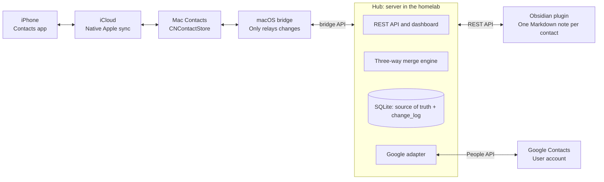

# Brevolt — Requirements specification

## Summary and goals

Brevolt is a self-hosted hub that keeps a single source of truth for contacts, editable from the iPhone, from Google Contacts and from Markdown notes in Obsidian, with enrichment data that does not fit in a vCard.

**Problem.** Contacts are scattered (iCloud, Google) and only support vCard fields. There is no place to add your own context (where you met someone, notes, relationships, links to other notes) without losing sync with the phone.

**Goals.**

1. A database on the server is the source of truth for all contacts.
2. Edit phones, emails and other fields from anywhere (iPhone, Mac, Google, Obsidian) and have the change reach everywhere else.
3. Enrich each contact with a free-form Markdown note, tags and custom fields that are never lost through a sync.
4. No silent data loss: visible conflicts, deletions confirmed by hand, full change history.
5. Deployable with a single `docker compose up` on your own infrastructure.

**MVP target user.** A single technical user, with an iPhone and a Mac on iCloud, a Google account and an Obsidian vault. Multi-user and other ecosystems come later.

## Scope

The MVP covers four pieces: a server with a database, the Google adapter, the macOS bridge to the Contacts app (iCloud) and the Obsidian plugin. Everything else is out until the basic loop works without data loss.

| Block | MVP | Later |
| --- | --- | --- |
| Server | REST API, SQLite, merge engine, `change_log`, minimal dashboard | Postgres, multi-user, own CardDAV server |
| Google | Two-way sync via People API | Google labels as groups, multiple accounts |
| Apple | macOS bridge in the menu bar | iOS bridge (BGAppRefreshTask or App Intent via Shortcuts) |
| Obsidian | Plugin that talks to the API; one note per contact | File mode (vault mounted on the server), templates |
| Data | Name, phones, emails, addresses, company, job title, birthday, URLs, Markdown note, tags, custom fields | Photos, relationships between contacts, interaction timeline |
| Security | Per-client API token, access via Tailscale | OIDC, field-level encryption at rest |

**Explicitly out of scope:** CRM (pipelines, follow-up reminders), calendar sync, Android, import from LinkedIn or other networks, and any automatic merging of duplicates without confirmation.

## Architecture

A hub on the server holds the truth and merges; three spokes (macOS bridge, Google adapter, Obsidian plugin) only read from and write to their own system. All decisions (conflicts, merges, deletions) are made in the dashboard.



iCloud keeps the iPhone and the Mac in sync on its own, so the macOS bridge covers both devices. The Google adapter runs inside the server; the iPhone may or may not have the Google account enabled in the Contacts app (see risks).

## Data model and normalization

Each contact has its own immutable UUID; iCloud and Google IDs are external references. Multi-value fields are stored as rows so they can be merged field by field.

| Table | Contents | Notes |
| --- | --- | --- |
| `contact` | `id` (UUID v7), name (prefix, given name, middle name, family names, suffix), nickname, company, job title, birthday, `note_md`, `created_at`, `updated_at`, `deleted_at` | `note_md` = free-form enrichment; never sent to Google or the Contacts app in the MVP |
| `contact_field` | `id`, `contact_id`, `kind` (phone, email, address, url), `label`, `value`, `normalized`, `position` | One row per value; merge key = `kind` + `normalized` |
| `tag` / `contact_tag` | Own tags | Only in the hub and in Obsidian |
| `custom_field` | `contact_id`, `key`, `value` | Free-form keys from the Obsidian frontmatter |
| `external_link` | `contact_id`, `system` (icloud, google, obsidian), `external_id`, `etag` | Unique per (`system`, `external_id`) |
| `sync_base` | `contact_id`, `system`, `snapshot` (normalized JSON), `hash`, `synced_at` | Base for the three-way merge, one per system |
| `change_log` | `id`, `ts`, `actor` (system or client), `contact_id`, `field`, `before`, `after`, `operation_id` | Insert-only; audit and undo |
| `conflict` | `id`, `contact_id`, `field`, `system`, `base`, `hub_value`, `external_value`, `status` | Pending until the user chooses |
| `client` | `id`, `kind` (bridge-macos, obsidian), `name`, `token_hash`, `cursor`, `last_seen` | One record per connected client |

**Normalization rules** (in a shared, tested module):

- **Phones:** E.164 with libphonenumber, configurable default region (ES). If it cannot be parsed, it is stored as-is and flagged.
- **Emails:** trim whitespace and lowercase.
- **Labels:** own vocabulary (`mobile`, `home`, `work`, `main`, `other`, or free text). Each adapter translates: Apple `_$!<Mobile>!$_`, Google `mobile`, vCard `TYPE=CELL`.
- **Dates:** ISO 8601; birthday without a year allowed (`--03-12`).
- **Names:** kept as-is; the display name is computed, not stored.

## Sync and merge engine

All merge logic lives on the server; clients (bridge, plugin) only send and apply changes. Each external system is merged against the hub, never against another system.

**Three-way merge, field by field.** For each contact and system, the base (`sync_base`), the current hub value and the incoming value are compared:

| Base → hub | Base → external | Result |
| --- | --- | --- |
| No change | Changed | External wins; applied to the hub |
| Changed | No change | Hub wins; sent to the external system |
| Changed | Changed to the same value | Nothing to do; the base is updated |
| Changed | Changed to a different value | Conflict: recorded, nothing is written anywhere |

**Multi-value fields** (phones, emails, addresses, URLs) are merged as sets keyed on `kind` + `normalized`: additions and removals from each side are applied; a label change on the same value is treated as a field change.

**Engine requirements:**

- **R-SYNC-1.** Pure function `merge(base, hub, external) → {hubPatch, externalPatch, conflicts}` with no I/O, tested with fixtures and property-based tests (idempotence: merging twice yields the same result; a one-sided change always wins).
- **R-SYNC-2.** After writing to an external system, the base and the etag are updated in the same transaction, so the next pull does not see a phantom change.
- **R-SYNC-3.** Each operation carries an idempotent `operation_id`; resending the same batch does not duplicate changes.
- **R-SYNC-4.** Conflicts, merge proposals and deletions are resolved only in the dashboard, choosing hub, external or a manual value; clients (bridge and plugin) only sync and never ask for decisions. On resolution, the value is propagated to all systems.
- **R-SYNC-5.** Optimistic writes: with etag (`If-Match` or equivalent) on Google; if the etag does not match, re-read and re-merge.

**Deletions.** A deletion detected in an external system does not delete in the hub: it marks the contact as `deleted-upstream` and puts it in the inbox for confirmation. A deletion confirmed in the hub performs a soft delete (`deleted_at`) and is propagated; it is purged after 30 days.

**New contacts and duplicates.** A new contact in an external system is first matched by normalized phone or email. If it matches an existing one, a merge proposal is created; it is never merged automatically.

**Initial import.** First iCloud (via the bridge), then Google in matching mode: everything that matches generates proposals; everything that doesn't becomes new contacts with their `external_link`.

**Loops.** Each write carries the `actor` that originated it; a client never receives its own changes back, and the bridge excludes its own writes from the Contacts history (see macOS bridge).

## Server

A single Node.js service in TypeScript that exposes the API, runs the adapters and serves the dashboard; it is deployed with Docker Compose and stores everything in SQLite.

**Proposed stack.** Node.js 22 LTS, strict TypeScript, Fastify, SQLite with Drizzle (versioned migrations), Zod to validate contracts, libphonenumber-js, Vitest. Dashboard in React served as static files by the same process. Monorepo with pnpm workspaces: `packages/core` (model, normalization, `merge`), `apps/server`, `apps/dashboard`, `apps/obsidian-plugin`, `apps/bridge-macos` (Swift).

**API (v1).** Bearer token authentication per client; all bodies validated with Zod.

| Method and route | Use |
| --- | --- |
| `GET /v1/contacts?updatedSince=&q=` | List and search |
| `GET /v1/contacts/:id` | Full record, including enrichment |
| `POST /v1/contacts` / `PATCH /v1/contacts/:id` / `DELETE /v1/contacts/:id` | Editing from the dashboard or Obsidian (PATCH with version `If-Match`) |
| `POST /v1/bridge/changes` | The bridge uploads Contacts deltas |
| `GET /v1/bridge/pending?cursor=` | The bridge requests changes to apply |
| `POST /v1/bridge/ack` | The bridge confirms the result per change |
| `GET /v1/conflicts` / `POST /v1/conflicts/:id/resolve` | Conflict inbox |
| `GET /v1/proposals` / `POST /v1/proposals/:id/accept` | Merges and deletions pending confirmation |
| `GET /v1/changes?contactId=` / `POST /v1/changes/:operationId/undo` | History and undo |
| `GET /v1/export?format=vcf\|json` | Full export |
| `GET /healthz` | Health and status of each adapter |

**Google adapter (People API).**

- OAuth 2.0 with the user's own client; refresh token encrypted in the database with a key from the environment.
- Incremental pull with `syncToken`; if it expires, full resync and normal merge.
- Push with the resource's etag; on an etag conflict, re-read and re-merge.
- Every 5 minutes by default, configurable, and on demand from the dashboard.
- Onboarding warns that the OAuth app must be in "In production" status: in "Testing" the refresh token expires after 7 days. The server detects the invalid token and shows it in the dashboard.

**Dashboard (MVP).**

1. Contact list with search and an editable record, enrichment included.
2. Inbox: conflicts, merge proposals and deletions awaiting confirmation.
3. Status: last sync per system, errors, connected clients and their `last_seen`.
4. Settings: connect Google, create and revoke client tokens, default phone region.

**Dashboard access.** A single admin user: password hashed with argon2id, set on first startup; session in an `HttpOnly`, `Secure` and `SameSite=Strict` cookie; and CSRF protection (see BRV-025).

**Deployment.** `docker-compose.yml` with one service and one volume for the database. Variables: `DATABASE_PATH`, `ENCRYPTION_KEY`, `GOOGLE_CLIENT_ID`, `GOOGLE_CLIENT_SECRET`, `PUBLIC_URL`. No internet exposure by default: access via Tailscale.

## macOS bridge

A Swift menu bar app that relays changes between the Mac's Contacts app and the server, with no merge logic. iCloud syncs the iPhone with the Mac, so a single bridge covers both.

**Functional requirements:**

- **R-BR-1.** On startup and on every `CNContactStoreDidChange`, read changes with `CNChangeHistoryFetchRequest` since the last token and upload them, normalized, to `POST /v1/bridge/changes` (Contacts identifier, container, fields).
- **R-BR-2.** Every 60 seconds and on demand, request `GET /v1/bridge/pending`, apply with `CNSaveRequest` and confirm with `POST /v1/bridge/ack`, reporting success or error per change.
- **R-BR-3.** Tag all of its writes with `transactionAuthor` and exclude them when reading history with `excludedTransactionAuthors`.
- **R-BR-4.** Minimal local state: history token, server cursor and API token. The mapping between Contacts identifier and UUID lives on the server (`external_link`), so it can be reinstalled without losing anything.
- **R-BR-5.** If the history token is no longer valid, perform a full read and send it as a snapshot; the server merges it like any other batch.
- **R-BR-6.** Respect the container: it only reads from and writes to the configured iCloud container. Google arrives through its own adapter on the server, not through the Mac.

**Interface.** Menu bar icon with status (synced, pending, error), last sync, number of pending changes, "Sync now" and "Pause" buttons, and settings (server URL, token in the Keychain, container). Launches at login.

**Permissions and distribution.** Requires full access to Contacts. The Contacts app's Notes field is neither read nor written in the MVP: it needs an entitlement that Apple grants on request. Initial distribution signed and notarized outside the App Store.

**Bridge contract (summary).** An incoming change carries `operation_id`, `local_id`, `container_id`, `kind` (upsert or delete) and the contact's full fields after the change. A pending change carries `operation_id`, `contact_id`, `local_id` (if it exists) and the full contact to write. The ack carries `operation_id`, `status` and the resulting `local_id` for new contacts.

## Obsidian plugin and Markdown format

The plugin projects each hub contact into a note and sends back to the server whatever is edited in it; it works on desktop and mobile using `requestUrl`. It only syncs the vault with the hub; the bridge to the Contacts app is the macOS app.

**Note format.** One note per contact in a configurable folder (`Contacts/` by default), with the display name as the file name. The frontmatter uses VCF Contacts keys (vCard 4.0) to be compatible with that plugin and with Google Contacts Sync; the `cf-*` keys belong to the hub.

```markdown
---
cf-id: 0193f6c2-8a4e-7b1d-9c3a-2f5e8d1b7a60
cf-version: 42
N.GN: Ana
N.FN: Pérez
FN: Ana Pérez
ORG: Acme
"TEL[CELL]": "+34600000000"
"EMAIL[WORK]": ana@acme.com
BDAY: 1985-03-12
tags: [contact, work]
met-at: "[[Codemotion 2025]]"
---
Free-form notes about Ana, links and context.
```

**Field ownership:**

| Part of the note | Synced with | Source of truth |
| --- | --- | --- |
| vCard keys (`N.*`, `FN`, `TEL[...]`, `EMAIL[...]`, `ADR[...]`, `ORG`, `TITLE`, `BDAY`, `URL[...]`) | Hub, and from there iCloud and Google | Hub, with merge |
| `tags` and any other key | Hub (`tag`, `custom_field`) | Hub; never leaves for iCloud or Google |
| Note body | Hub (`note_md`) | Hub; never leaves for iCloud or Google |
| `cf-id`, `cf-version` | Read-only | Hub; the plugin does not allow editing them |

**Functional requirements:**

- **R-OB-1.** Periodic pull (configurable, 5 minutes by default) and on opening the vault: `GET /v1/contacts?updatedSince=` and rewrite of the affected notes.
- **R-OB-2.** On saving a contact note, with a 3-second debounce after the last edit, `PATCH /v1/contacts/:id` with `If-Match: cf-version`. If the version does not match, the server merges and the plugin rewrites the note with the result.
- **R-OB-3.** Write notes with the Obsidian vault API (`processFrontMatter` for the frontmatter), never overwriting the whole file, so as not to clobber in-progress edits.
- **R-OB-4.** A new note in the contacts folder without `cf-id` = new contact: `POST /v1/contacts` and the returned `cf-id` is written.
- **R-OB-5.** Deleting a note does not delete the contact: it creates a deletion proposal on the server.
- **R-OB-6.** The plugin does not resolve conflicts. If a contact has a pending conflict, the note shows a read-only notice with a link to the conflict in the dashboard, and its managed keys are not sent until it is resolved.
- **R-OB-7.** Renaming a note does not change the contact's name; renaming the contact renames the note with Obsidian's file manager, so that links are updated.
- **R-OB-8.** Commands: "Sync now" and "Open in dashboard". Plugin settings: Brevolt server URL (for self-hosted installs), API key generated in the dashboard, contacts folder and sync interval; "Test connection" button.

## Non-functional requirements

The priority is never to lose data; performance only needs to be enough for a few thousand contacts.

| Area | Requirement |
| --- | --- |
| Integrity | No write to an external system without going through `merge`; no deletion propagated without confirmation; every write leaves a row in `change_log` |
| Security | Client tokens stored as hashes; Google refresh token encrypted (AES-256-GCM, key in `ENCRYPTION_KEY`); no internet access by default (Tailscale); HTTPS mandatory if exposed |
| Privacy | No telemetry; data only leaves the server towards the systems the user connects |
| Backups | Daily SQLite copy with `VACUUM INTO` to a separate volume, 30-day retention; vCard and JSON export on demand; automatic backup before each migration |
| Observability | Structured JSON logs with `operation_id`; `/healthz` with each adapter's status; sync errors visible in the dashboard |
| Performance | Up to 5,000 contacts; incremental sync under 5 seconds; initial import under 2 minutes |
| Fail-safety | Per-system dry-run mode (computes the diff without writing) enabled by default on each system's first connection |
| Tests | `merge` and normalization with high coverage and property-based tests; adapters with recorded People API and Contacts fixtures; one end-to-end test with all three systems simulated |
| License | Open source (MIT or AGPL-3.0, to be decided in BRV-004) |

## Security by design (open source)

The code is public, so it cannot contain any secret, and security must come from the code itself and the default configuration, not from nobody seeing the repository.

**Secrets outside the repository:**

- **R-SEC-1.** Zero secrets in code, configuration, tests or git history: no API keys, no tokens, no Google client ID or secret, no certificates, no private URLs. Everything comes in through environment variables or Docker secrets (`*_FILE` variants).
- **R-SEC-2.** `.env.example` with placeholders only (`GOOGLE_CLIENT_SECRET=change-me`); `.env` and any credentials file in `.gitignore`.
- **R-SEC-3.** The project never distributes shared credentials: each user creates their own Google OAuth client and generates their own client tokens.
- **R-SEC-4.** No default values for secrets: the server does not start if `ENCRYPTION_KEY` is missing or shorter than 32 bytes, and says so clearly in the log.
- **R-SEC-5.** Blocking secret scanning: gitleaks in pre-commit and in CI, and secret scanning with push protection enabled on GitHub. If a secret ever gets published, it is rotated; removing it from history is not enough.
- **R-SEC-6.** Tests and fixtures with synthetic data only; never real contacts or real, non-anonymized API responses.

**Security in the code:**

- **R-SEC-7.** Client tokens with minimal scope: the bridge's only accesses `/v1/bridge/*`, Obsidian's only contacts. They are stored as hashes, revoked from the dashboard and expire if unused for 90 days.
- **R-SEC-8.** Strict Zod validation of all input, body size limits, parameterized queries, rate limiting on authentication, CORS closed by default and security headers.
- **R-SEC-9.** Logs without personal data or secrets: phones, emails, names and tokens are redacted, at debug level too.
- **R-SEC-10.** Secrets encrypted at rest (Google refresh token with AES-256-GCM); consider encrypting the whole database in a later phase.
- **R-SEC-11.** macOS bridge: token in the Keychain, never in preference files. Signing certificates and notarization credentials only as CI secrets.
- **R-SEC-12.** Obsidian plugin: plugin settings are stored inside the vault and may end up synced or in git. Use the system secret store when Obsidian offers one; otherwise, warn in the settings and rely on minimal scope and token revocation.

**Supply chain and repository:**

- **R-SEC-13.** Mandatory lockfile, minimal dependencies, Renovate or Dependabot, `pnpm audit` and CodeQL in CI.
- **R-SEC-14.** Docker image with a minimal base, non-root user and read-only file system except for the data volume; image signed with cosign and SBOM published on every release.
- **R-SEC-15.** Protected main branch, mandatory review, signed commits and a `SECURITY.md` explaining how to report vulnerabilities privately.

## Work plan

The detailed plan, with phases, issues, acceptance criteria, tests and quality gates, is in [`docs/backlog.md`](backlog.md). Summary of the order:

1. **Phase 0 — Risk spikes:** Contacts history on macOS, People API, networking and frontmatter in the plugin, stack ADR.
2. **Phase 1 — Foundations and core:** monorepo, CI and repository security, model, normalization and `merge`.
3. **Phase 2 — Server and dashboard:** database, auth, contacts API, dashboard, Docker and backups.
4. **Phase 3 — macOS bridge:** sync orchestration, decision inbox, dry-run and menu bar app.
5. **Phase 4 — Obsidian:** Markdown mapping and plugin.
6. **Phase 5 — Google:** OAuth, pull, push and import with matching.
7. **Phase 6 — Release 1.0:** documentation, security review, move to production and v1.0.0.

Google comes after Apple and Obsidian because it adds import with duplicates, the most delicate part; it is better for the engine to already be proven with fewer systems.

## Risks and open decisions

The biggest risk is a faulty merge that deletes or duplicates real contacts; that is why dry-run, backups and deletion confirmation ship from the very first version.

| Risk | Mitigation |
| --- | --- |
| Merge that corrupts real data | Dry-run by default, daily backups, `change_log` with undo, testing only with test accounts until phase 5 |
| Phantom changes due to labels or formats | Own label vocabulary and shared normalization, with per-adapter tests |
| Google token silently expired | OAuth app in "In production", detection and warning in the dashboard |
| Mac powered off: iPhone changes are delayed | Accepted in the MVP; iOS bridge as a later phase |
| Duplicates between iCloud and Google | Matching by phone or email and manual proposals |
| Simultaneous edits in Obsidian and on the iPhone | Per-contact version (`cf-version`) and merge on the server |

**Open decisions:**

- [x] Project name: Brevolt.
- [ ] License: MIT or AGPL-3.0 (decided in BRV-004).
- [ ] Build it as a standalone project or propose the Obsidian part to VCF Contacts.
- [ ] Whether the note body should ever reach the Notes field in the Contacts app or Google, and in what format.
- [ ] Default phone region and behavior with numbers without an international prefix.

## References and existing projects

None of the projects reviewed covers two-way editing with iCloud and Google with Markdown as an editable projection; these are the closest ones and what to take from each.

| Project | What it does | What to take |
| --- | --- | --- |
| [VCF Contacts](https://community.obsidian.md/plugins/vcf-contacts) | Contacts as notes with vCard 4.0 frontmatter; CardDAV sync where devices only read | Frontmatter format; possible collaboration on the two-way part |
| [Google Contacts Sync](https://community.obsidian.md/plugins/google-contacts) | Imports Google into notes, one-way into Obsidian only, preserving the body | Format mode compatible with VCF Contacts |
| [Contact plugins for Obsidian](https://obsidianstats.com/tags/contact) | iCloud Contacts and Sync Contacts on macOS: one-way sync | Use cases and user complaints |
| [Monica](https://github.com/monicahq/monica/issues/2738) | Self-hosted personal CRM, CardDAV server | Example of what to avoid: silent deletions from CardDAV |
| [Markway](https://www.obsidianstats.com/plugins/markway) | macOS app that bridges Apple services and Markdown | Pattern of a native app with permissions plus a lightweight plugin |
| [VaultSync](https://apps.apple.com/app/id6761845197) | iOS app that writes to the Obsidian vault | Proof that an external app can write to the vault on iOS |
