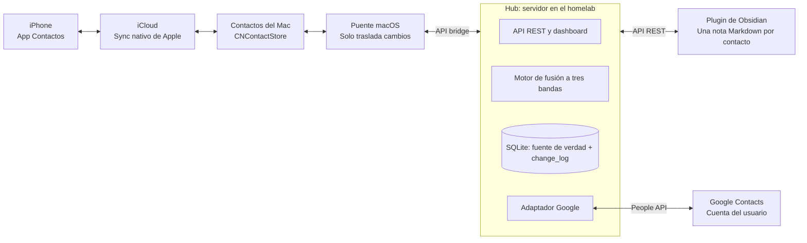

# Brevolt — Especificación de requisitos

## Resumen y objetivos

Brevolt es un hub self-hosted que mantiene una única fuente de verdad de contactos, editable desde el iPhone, desde Google Contacts y desde notas Markdown en Obsidian, con datos de enriquecimiento que no caben en un vCard.

**Problema.** Los contactos viven repartidos (iCloud, Google) y solo admiten los campos del vCard. No hay un sitio donde añadir contexto propio (dónde conociste a alguien, notas, relaciones, enlaces a otras notas) sin perder la sincronización con el teléfono.

**Objetivos.**

1. Una base de datos en el servidor es la fuente de verdad de todos los contactos.
2. Editar teléfonos, emails y demás campos desde cualquier lado (iPhone, Mac, Google, Obsidian) y que el cambio llegue al resto.
3. Enriquecer cada contacto con nota libre en Markdown, etiquetas y campos propios que nunca se pierden por un sync.
4. Sin pérdida silenciosa de datos: conflictos visibles, borrados confirmados a mano, historial completo de cambios.
5. Desplegable con un `docker compose up` en infraestructura propia.

**Usuario objetivo del MVP.** Un único usuario técnico, con iPhone y Mac en iCloud, cuenta de Google y vault de Obsidian. Multiusuario y otros ecosistemas quedan para después.

## Alcance

El MVP cubre cuatro piezas: servidor con base de datos, adaptador de Google, puente de macOS hacia Contactos (iCloud) y plugin de Obsidian. Todo lo demás queda fuera hasta que el ciclo básico funcione sin pérdida de datos.

| Bloque | MVP | Después |
| --- | --- | --- |
| Servidor | API REST, SQLite, motor de fusión, `change_log`, dashboard mínimo | Postgres, multiusuario, servidor CardDAV propio |
| Google | Sync bidireccional por People API | Etiquetas de Google como grupos, varias cuentas |
| Apple | Puente de macOS en barra de menú | Puente iOS (BGAppRefreshTask o App Intent vía Atajos) |
| Obsidian | Plugin que habla con la API; una nota por contacto | Modo fichero (vault montado en el servidor), plantillas |
| Datos | Nombre, teléfonos, emails, direcciones, empresa, cargo, cumpleaños, URLs, nota Markdown, etiquetas, campos propios | Fotos, relaciones entre contactos, línea de tiempo de interacciones |
| Seguridad | Token de API por cliente, acceso por Tailscale | OIDC, cifrado en reposo de campos |

**Fuera de alcance explícito:** CRM (pipelines, recordatorios de seguimiento), sincronización de calendarios, Android, importación desde LinkedIn u otras redes, y cualquier fusión automática de duplicados sin confirmación.

## Arquitectura

Un hub en el servidor guarda la verdad y fusiona; tres radios (puente de macOS, adaptador de Google, plugin de Obsidian) solo leen y escriben cada uno en su sistema. Todas las decisiones (conflictos, fusiones, borrados) se toman en el dashboard.



iCloud mantiene el iPhone y el Mac sincronizados por su cuenta, así que el puente de macOS cubre los dos dispositivos. El adaptador de Google corre dentro del servidor; el iPhone puede tener o no la cuenta de Google activa en Contactos (ver riesgos).

## Modelo de datos y normalización

Cada contacto tiene un UUID propio e inmutable; los IDs de iCloud y Google son referencias externas. Los campos multivalor se guardan como filas para poder fusionar campo a campo.

| Tabla | Contenido | Notas |
| --- | --- | --- |
| `contact` | `id` (UUID v7), nombre (prefijo, nombre, segundo nombre, apellidos, sufijo), apodo, empresa, cargo, cumpleaños, `note_md`, `created_at`, `updated_at`, `deleted_at` | `note_md` = enriquecimiento libre; nunca se envía a Google ni a Contactos en el MVP |
| `contact_field` | `id`, `contact_id`, `kind` (phone, email, address, url), `label`, `value`, `normalized`, `position` | Una fila por valor; clave de fusión = `kind` + `normalized` |
| `tag` / `contact_tag` | Etiquetas propias | Solo en el hub y en Obsidian |
| `custom_field` | `contact_id`, `key`, `value` | Claves libres del frontmatter de Obsidian |
| `external_link` | `contact_id`, `system` (icloud, google, obsidian), `external_id`, `etag` | Única por (`system`, `external_id`) |
| `sync_base` | `contact_id`, `system`, `snapshot` (JSON normalizado), `hash`, `synced_at` | Base de la fusión a tres bandas, una por sistema |
| `change_log` | `id`, `ts`, `actor` (sistema o cliente), `contact_id`, `field`, `before`, `after`, `operation_id` | Solo inserción; auditoría y deshacer |
| `conflict` | `id`, `contact_id`, `field`, `system`, `base`, `hub_value`, `external_value`, `status` | Pendiente hasta que el usuario elige |
| `client` | `id`, `kind` (bridge-macos, obsidian), `name`, `token_hash`, `cursor`, `last_seen` | Un registro por cliente conectado |

**Reglas de normalización** (en un módulo compartido y con tests):

- **Teléfonos:** E.164 con libphonenumber, región por defecto configurable (ES). Si no se puede parsear, se guarda tal cual y se marca.
- **Emails:** recortar espacios y pasar a minúsculas.
- **Etiquetas:** vocabulario propio (`mobile`, `home`, `work`, `main`, `other`, o texto libre). Cada adaptador traduce: Apple `_$!<Mobile>!$_`, Google `mobile`, vCard `TYPE=CELL`.
- **Fechas:** ISO 8601; cumpleaños sin año permitido (`--03-12`).
- **Nombres:** se conservan tal cual; el nombre visible se calcula, no se guarda.

## Motor de sincronización y fusión

Toda la lógica de fusión vive en el servidor; los clientes (puente, plugin) solo envían y aplican cambios. Cada sistema externo se fusiona contra el hub, nunca contra otro sistema.

**Fusión a tres bandas, campo a campo.** Para cada contacto y sistema se compara la base (`sync_base`), el valor actual del hub y el valor entrante:

| Base → hub | Base → externo | Resultado |
| --- | --- | --- |
| Sin cambio | Cambió | Gana el externo; se aplica al hub |
| Cambió | Sin cambio | Gana el hub; se envía al externo |
| Cambió | Cambió al mismo valor | Nada que hacer; se actualiza la base |
| Cambió | Cambió a otro valor | Conflicto: se registra, no se escribe en ningún lado |

**Campos multivalor** (teléfonos, emails, direcciones, URLs) se fusionan como conjuntos con clave en `kind` + `normalized`: altas y bajas de cada lado se aplican; un cambio de etiqueta sobre el mismo valor se trata como cambio de campo.

**Requisitos del motor:**

- **R-SYNC-1.** Función pura `merge(base, hub, external) → {hubPatch, externalPatch, conflicts}` sin E/S, testeada con fixtures y tests de propiedades (idempotencia: fusionar dos veces da lo mismo; un cambio de un solo lado siempre gana).
- **R-SYNC-2.** Tras escribir en un sistema externo, la base y el etag se actualizan en la misma transacción, para que el siguiente pull no vea un cambio fantasma.
- **R-SYNC-3.** Cada operación lleva un `operation_id` idempotente; reenviar el mismo lote no duplica cambios.
- **R-SYNC-4.** Los conflictos, las propuestas de fusión y los borrados se resuelven únicamente en el dashboard, eligiendo hub, externo o un valor manual; los clientes (puente y plugin) solo sincronizan y nunca piden decisiones. Al resolver, el valor se propaga a todos los sistemas.
- **R-SYNC-5.** Escrituras optimistas: con etag (`If-Match` o equivalente) en Google; si el etag no coincide, se vuelve a leer y fusionar.

**Borrados.** Un borrado detectado en un sistema externo no borra en el hub: marca el contacto como `deleted-upstream` y lo pone en la bandeja para confirmar. Un borrado confirmado en el hub hace soft delete (`deleted_at`) y se propaga; se purga a los 30 días.

**Altas y duplicados.** Un contacto nuevo en un sistema externo se empareja primero por teléfono o email normalizado. Si coincide con uno existente, se crea una propuesta de fusión; nunca se fusiona solo.

**Importación inicial.** Primero iCloud (vía puente), luego Google en modo emparejamiento: todo lo que coincide genera propuestas, lo que no, contactos nuevos con su `external_link`.

**Bucles.** Cada escritura lleva el `actor` que la originó; un cliente nunca recibe de vuelta sus propios cambios, y el puente excluye sus escrituras del historial de Contactos (ver puente de macOS).

## Servidor

Un único servicio en Node.js con TypeScript que expone la API, ejecuta los adaptadores y sirve el dashboard; se despliega con Docker Compose y guarda todo en SQLite.

**Stack propuesto.** Node.js 22 LTS, TypeScript estricto, Fastify, SQLite con Drizzle (migraciones versionadas), Zod para validar contratos, libphonenumber-js, Vitest. Dashboard en React servido como estáticos por el mismo proceso. Monorepo con pnpm workspaces: `packages/core` (modelo, normalización, `merge`), `apps/server`, `apps/dashboard`, `apps/obsidian-plugin`, `apps/bridge-macos` (Swift).

**API (v1).** Autenticación por token Bearer por cliente; todos los cuerpos validados con Zod.

| Método y ruta | Uso |
| --- | --- |
| `GET /v1/contacts?updatedSince=&q=` | Listar y buscar |
| `GET /v1/contacts/:id` | Ficha completa, con enriquecimiento |
| `POST /v1/contacts` / `PATCH /v1/contacts/:id` / `DELETE /v1/contacts/:id` | Edición desde dashboard u Obsidian (PATCH con `If-Match` de versión) |
| `POST /v1/bridge/changes` | El puente sube deltas de Contactos |
| `GET /v1/bridge/pending?cursor=` | El puente pide cambios a aplicar |
| `POST /v1/bridge/ack` | El puente confirma resultado por cambio |
| `GET /v1/conflicts` / `POST /v1/conflicts/:id/resolve` | Bandeja de conflictos |
| `GET /v1/proposals` / `POST /v1/proposals/:id/accept` | Fusiones y borrados pendientes de confirmar |
| `GET /v1/changes?contactId=` / `POST /v1/changes/:operationId/undo` | Historial y deshacer |
| `GET /v1/export?format=vcf\|json` | Exportación completa |
| `GET /healthz` | Salud y estado de cada adaptador |

**Adaptador de Google (People API).**

- OAuth 2.0 con el cliente propio del usuario; refresh token cifrado en la base de datos con una clave de entorno.
- Pull incremental con `syncToken`; si caduca, resincronización completa y fusión normal.
- Push con el etag del recurso; en conflicto de etag, releer y refusionar.
- Cada 5 minutos por defecto, configurable, y bajo demanda desde el dashboard.
- El onboarding avisa de que la app OAuth debe estar en estado "In production": en "Testing" el refresh token caduca a los 7 días. El servidor detecta el token inválido y lo muestra en el dashboard.

**Dashboard (MVP).**

1. Lista de contactos con búsqueda y ficha editable, enriquecimiento incluido.
2. Bandeja: conflictos, propuestas de fusión y borrados por confirmar.
3. Estado: último sync por sistema, errores, clientes conectados y su `last_seen`.
4. Ajustes: conectar Google, crear y revocar tokens de cliente, región por defecto de teléfonos.

**Acceso al dashboard.** Un único usuario administrador: contraseña con hash argon2id fijada en el primer arranque, sesión en cookie `HttpOnly`, `Secure` y `SameSite=Strict`, y protección CSRF (ver BRV-025).

**Despliegue.** `docker-compose.yml` con un servicio y un volumen para la base de datos. Variables: `DATABASE_PATH`, `ENCRYPTION_KEY`, `GOOGLE_CLIENT_ID`, `GOOGLE_CLIENT_SECRET`, `PUBLIC_URL`. Sin exposición a internet por defecto: acceso por Tailscale.

## Puente de macOS

Una app de barra de menú en Swift que traslada cambios entre Contactos del Mac y el servidor, sin lógica de fusión. iCloud sincroniza el iPhone con el Mac, así que un único puente cubre los dos.

**Requisitos funcionales:**

- **R-BR-1.** Al arrancar y en cada `CNContactStoreDidChange`, leer los cambios con `CNChangeHistoryFetchRequest` desde el último token y subirlos a `POST /v1/bridge/changes` normalizados (identificador de Contactos, contenedor, campos).
- **R-BR-2.** Cada 60 segundos y bajo demanda, pedir `GET /v1/bridge/pending`, aplicar con `CNSaveRequest` y confirmar con `POST /v1/bridge/ack`, indicando éxito o error por cambio.
- **R-BR-3.** Marcar todas sus escrituras con `transactionAuthor` y excluirlas al leer el historial con `excludedTransactionAuthors`.
- **R-BR-4.** Estado local mínimo: token de historial, cursor del servidor y token de API. La correspondencia entre identificador de Contactos y UUID vive en el servidor (`external_link`), para poder reinstalar sin perder nada.
- **R-BR-5.** Si el token de historial deja de ser válido, hacer una lectura completa y enviarla como instantánea; el servidor la fusiona como cualquier otro lote.
- **R-BR-6.** Respetar el contenedor: solo lee y escribe en el contenedor de iCloud configurado. Google llega por su propio adaptador en el servidor, no a través del Mac.

**Interfaz.** Icono en la barra de menú con estado (sincronizado, pendiente, error), último sync, número de cambios pendientes, botones "Sincronizar ahora" y "Pausar", y ajustes (URL del servidor, token en el Llavero, contenedor). Se lanza al iniciar sesión.

**Permisos y distribución.** Requiere acceso completo a Contactos. El campo Notas de Contactos no se lee ni se escribe en el MVP: necesita un entitlement que Apple concede a demanda. Distribución inicial firmada y notarizada fuera del App Store.

**Contrato del puente (resumen).** Un cambio entrante lleva `operation_id`, `local_id`, `container_id`, `kind` (upsert o delete) y los campos completos del contacto tras el cambio. Un cambio pendiente lleva `operation_id`, `contact_id`, `local_id` (si existe) y el contacto completo a escribir. El ack lleva `operation_id`, `status` y el `local_id` resultante en las altas.

## Plugin de Obsidian y formato Markdown

El plugin proyecta cada contacto del hub en una nota y devuelve al servidor lo que se edite en ella; funciona en escritorio y móvil usando `requestUrl`. Solo sincroniza el vault con el hub; el puente con Contactos es la app de macOS.

**Formato de nota.** Una nota por contacto en una carpeta configurable (por defecto `Contacts/`), con el nombre visible como nombre de fichero. El frontmatter usa las claves de VCF Contacts (vCard 4.0) para ser compatible con ese plugin y con Google Contacts Sync; las claves `cf-*` son propias del hub.

```markdown
---
cf-id: 0193f6c2-8a4e-7b1d-9c3a-2f5e8d1b7a60
cf-version: 42
N.GN: Ana
N.FN: Pérez
FN: Ana Pérez
ORG: Acme
"TEL[CELL]": "+34600000000"
"EMAIL[WORK]": ana@acme.com
BDAY: 1985-03-12
tags: [contacto, trabajo]
conocida-en: "[[Codemotion 2025]]"
---
Notas libres sobre Ana, enlaces y contexto.
```

**Propiedad de los campos:**

| Parte de la nota | Se sincroniza con | Origen de la verdad |
| --- | --- | --- |
| Claves vCard (`N.*`, `FN`, `TEL[...]`, `EMAIL[...]`, `ADR[...]`, `ORG`, `TITLE`, `BDAY`, `URL[...]`) | Hub, y de ahí iCloud y Google | Hub, con fusión |
| `tags` y cualquier otra clave | Hub (`tag`, `custom_field`) | Hub; nunca sale hacia iCloud ni Google |
| Cuerpo de la nota | Hub (`note_md`) | Hub; nunca sale hacia iCloud ni Google |
| `cf-id`, `cf-version` | Solo lectura | Hub; el plugin no deja editarlas |

**Requisitos funcionales:**

- **R-OB-1.** Pull periódico (configurable, 5 minutos por defecto) y al abrir el vault: `GET /v1/contacts?updatedSince=` y reescritura de las notas afectadas.
- **R-OB-2.** Al guardar una nota de contacto, con 3 segundos de espera tras la última edición, `PATCH /v1/contacts/:id` con `If-Match: cf-version`. Si la versión no coincide, el servidor fusiona y el plugin reescribe la nota con el resultado.
- **R-OB-3.** Escribir notas con la API del vault de Obsidian (`processFrontMatter` para el frontmatter), nunca sobrescribiendo el fichero completo, para no pisar ediciones en curso.
- **R-OB-4.** Nota nueva en la carpeta de contactos sin `cf-id` = contacto nuevo: `POST /v1/contacts` y se escribe el `cf-id` devuelto.
- **R-OB-5.** Borrar una nota no borra el contacto: crea una propuesta de borrado en el servidor.
- **R-OB-6.** El plugin no resuelve conflictos. Si un contacto tiene un conflicto pendiente, la nota muestra un aviso de solo lectura con un enlace al conflicto en el dashboard, y sus claves gestionadas no se envían hasta que se resuelva.
- **R-OB-7.** Renombrar una nota no cambia el nombre del contacto; renombrar el contacto renombra la nota con el gestor de ficheros de Obsidian, para que los enlaces se actualicen.
- **R-OB-8.** Comandos: "Sincronizar ahora" y "Abrir en dashboard". Ajustes del plugin: URL del servidor Brevolt (para instalaciones self-hosted), API key generada en el dashboard, carpeta de contactos e intervalo de sync; botón "Probar conexión".

## Requisitos no funcionales

La prioridad es no perder datos nunca; el rendimiento solo tiene que bastar para unos pocos miles de contactos.

| Área | Requisito |
| --- | --- |
| Integridad | Ninguna escritura en un sistema externo sin pasar por `merge`; ningún borrado propagado sin confirmación; toda escritura deja una fila en `change_log` |
| Seguridad | Tokens de cliente guardados como hash; refresh token de Google cifrado (AES-256-GCM, clave en `ENCRYPTION_KEY`); sin acceso desde internet por defecto (Tailscale); HTTPS obligatorio si se expone |
| Privacidad | Sin telemetría; los datos solo salen del servidor hacia los sistemas que el usuario conecta |
| Backups | Copia diaria de SQLite con `VACUUM INTO` a un volumen aparte, 30 días de retención; exportación vCard y JSON bajo demanda; copia previa automática antes de cada migración |
| Observabilidad | Logs JSON estructurados con `operation_id`; `/healthz` con el estado de cada adaptador; errores de sync visibles en el dashboard |
| Rendimiento | Hasta 5.000 contactos; sync incremental por debajo de 5 segundos; importación inicial por debajo de 2 minutos |
| Seguridad ante fallos | Modo dry-run por sistema (calcula el diff sin escribir) activado por defecto en la primera conexión de cada sistema |
| Tests | `merge` y normalización con cobertura alta y tests de propiedades; adaptadores con fixtures grabadas de People API y de Contactos; un test de extremo a extremo con los tres sistemas simulados |
| Licencia | Open source (MIT o AGPL-3.0, por decidir en BRV-004) |

## Seguridad por diseño (open source)

El código es público, así que no puede contener ningún secreto y la seguridad tiene que venir del propio código y de la configuración por defecto, no de que nadie vea el repositorio.

**Secretos fuera del repositorio:**

- **R-SEC-1.** Cero secretos en el código, la configuración, los tests o el historial de git: ni API keys, ni tokens, ni client ID o secret de Google, ni certificados, ni URLs privadas. Todo entra por variables de entorno o Docker secrets (variantes `*_FILE`).
- **R-SEC-2.** `.env.example` solo con marcadores (`GOOGLE_CLIENT_SECRET=change-me`); `.env` y cualquier fichero de credenciales en `.gitignore`.
- **R-SEC-3.** El proyecto nunca distribuye credenciales compartidas: cada usuario crea su propio cliente OAuth de Google y genera sus propios tokens de cliente.
- **R-SEC-4.** Sin valores por defecto para secretos: el servidor no arranca si falta `ENCRYPTION_KEY` o tiene menos de 32 bytes, y lo dice claramente en el log.
- **R-SEC-5.** Escaneo de secretos bloqueante: gitleaks en pre-commit y en CI, y secret scanning con push protection activado en GitHub. Si un secreto llega a publicarse, se rota; borrarlo del historial no basta.
- **R-SEC-6.** Tests y fixtures solo con datos sintéticos; nunca contactos reales ni respuestas reales de APIs sin anonimizar.

**Seguridad en el código:**

- **R-SEC-7.** Tokens de cliente con alcance mínimo: el del puente solo accede a `/v1/bridge/*`, el de Obsidian solo a contactos. Se guardan como hash, se revocan desde el dashboard y caducan si no se usan en 90 días.
- **R-SEC-8.** Validación estricta con Zod de toda entrada, límites de tamaño de cuerpo, consultas parametrizadas, rate limiting en autenticación, CORS cerrado por defecto y cabeceras de seguridad.
- **R-SEC-9.** Logs sin datos personales ni secretos: teléfonos, emails, nombres y tokens se redactan, también en nivel debug.
- **R-SEC-10.** Secretos en reposo cifrados (refresh token de Google con AES-256-GCM); valorar cifrar la base de datos completa en una fase posterior.
- **R-SEC-11.** Puente de macOS: token en el Llavero, nunca en ficheros de preferencias. Certificados de firma y credenciales de notarización solo como secretos de CI.
- **R-SEC-12.** Plugin de Obsidian: los ajustes del plugin se guardan dentro del vault y pueden acabar sincronizados o en git. Usar el almacén de secretos del sistema cuando Obsidian lo ofrezca; si no, avisar en los ajustes y apoyarse en el alcance mínimo y la revocación del token.

**Cadena de suministro y repositorio:**

- **R-SEC-13.** Lockfile obligatorio, dependencias mínimas, Renovate o Dependabot, `pnpm audit` y CodeQL en CI.
- **R-SEC-14.** Imagen Docker con base mínima, usuario no root y sistema de ficheros de solo lectura salvo el volumen de datos; imagen firmada con cosign y SBOM publicado en cada release.
- **R-SEC-15.** Rama principal protegida, revisión obligatoria, commits firmados y `SECURITY.md` con cómo reportar vulnerabilidades en privado.

## Plan de trabajo

El plan detallado, con fases, issues, criterios de aceptación, tests y puertas de calidad, está en [`docs/backlog.md`](backlog.md). Resumen del orden:

1. **Fase 0 — Spikes de riesgo:** historial de Contactos en macOS, People API, red y frontmatter en el plugin, ADR de stack.
2. **Fase 1 — Fundaciones y núcleo:** monorepo, CI y seguridad del repositorio, modelo, normalización y `merge`.
3. **Fase 2 — Servidor y dashboard:** base de datos, auth, API de contactos, dashboard, Docker y backups.
4. **Fase 3 — Puente macOS:** orquestación de sync, bandeja de decisiones, dry-run y app de barra de menú.
5. **Fase 4 — Obsidian:** mapeo Markdown y plugin.
6. **Fase 5 — Google:** OAuth, pull, push e importación con emparejamiento.
7. **Fase 6 — Release 1.0:** documentación, revisión de seguridad, paso a producción y v1.0.0.

Google va después de Apple y Obsidian porque añade la importación con duplicados, la parte más delicada; conviene que el motor ya esté probado con menos sistemas.

## Riesgos y decisiones abiertas

El mayor riesgo es una fusión defectuosa que borre o duplique contactos reales; por eso el dry-run, los backups y la confirmación de borrados van desde la primera versión.

| Riesgo | Mitigación |
| --- | --- |
| Fusión que corrompe datos reales | Dry-run por defecto, backups diarios, `change_log` con deshacer, pruebas solo con cuentas de prueba hasta la fase 5 |
| Cambios fantasma por etiquetas o formatos | Vocabulario propio de etiquetas y normalización compartida, con tests por adaptador |
| Token de Google caducado en silencio | App OAuth en "In production", detección y aviso en el dashboard |
| Mac apagado: los cambios del iPhone tardan | Aceptado en el MVP; puente iOS como fase posterior |
| Duplicados entre iCloud y Google | Emparejamiento por teléfono o email y propuestas manuales |
| Ediciones simultáneas en Obsidian y en el iPhone | Versión por contacto (`cf-version`) y fusión en el servidor |

**Decisiones abiertas:**

- [x] Nombre del proyecto: Brevolt.
- [ ] Licencia: MIT o AGPL-3.0 (se decide en BRV-004).
- [ ] Construirlo como proyecto propio o proponer la parte de Obsidian a VCF Contacts.
- [ ] Si el cuerpo de la nota debe llegar alguna vez al campo Notas de Contactos o de Google, y en qué formato.
- [ ] Región por defecto de teléfonos y comportamiento con números sin prefijo internacional.

## Referencias y proyectos existentes

Ningún proyecto revisado cubre la edición bidireccional con iCloud y Google con Markdown como proyección editable; estos son los más cercanos y qué aprovechar de cada uno.

| Proyecto | Qué hace | Qué aprovechar |
| --- | --- | --- |
| [VCF Contacts](https://community.obsidian.md/plugins/vcf-contacts) | Contactos como notas con frontmatter vCard 4.0; sync CardDAV donde los dispositivos solo leen | Formato de frontmatter; posible colaboración en la parte bidireccional |
| [Google Contacts Sync](https://community.obsidian.md/plugins/google-contacts) | Importa Google a notas, solo hacia Obsidian, respetando el cuerpo | Modo de formato compatible con VCF Contacts |
| [Plugins de contactos para Obsidian](https://obsidianstats.com/tags/contact) | iCloud Contacts y Sync Contacts on macOS: sync en una sola dirección | Casos de uso y quejas de usuarios |
| [Monica](https://github.com/monicahq/monica/issues/2738) | CRM personal self-hosted, servidor CardDAV | Ejemplo de lo que evitar: borrados silenciosos desde CardDAV |
| [Markway](https://www.obsidianstats.com/plugins/markway) | App de macOS que hace de puente entre servicios de Apple y Markdown | Patrón de app nativa con permisos y plugin ligero |
| [VaultSync](https://apps.apple.com/app/id6761845197) | App iOS que escribe en el vault de Obsidian | Prueba de que una app externa puede escribir en el vault en iOS |
